# Screen Catalog — RemoteSEA Web

> Phần khung (route, PB, trạng thái, ảnh, cấu trúc DOM đo được) sinh tự động từ lần chụp 2026-10-21T14:11:02.888Z. Phần _Mục đích / Bố cục / Hành vi_ được viết tay trong `data/screen-notes.json` sau khi xem ảnh và đọc source.

Mức bằng chứng: **Runtime** = đã mở trên ứng dụng đang chạy · **Source** = chỉ đọc code · **Chưa xác minh**.

## Sprint 1 — Nền tảng hệ thống, Xác thực & Danh mục chuẩn

### S1-LOGIN — Đăng nhập

| Thuộc tính         | Giá trị                                                                                                                                                                                        |
| ------------------ | ---------------------------------------------------------------------------------------------------------------------------------------------------------------------------------------------- |
| Sprint             | 1                                                                                                                                                                                              |
| PB                 | PB02 (Đăng nhập bằng email và mật khẩu) PB03 (Xác thực hai lớp khi đăng nhập (2FA Challenge)) PB04 (Đăng nhập bằng Google, GitHub hoặc LinkedIn (OAuth)) PB06 (Yêu cầu quên mật khẩu) |
| Actor chụp         | guest                                                                                                                                                                                          |
| Route              | `/login` (đã mở: `/login`)                                                                                                                                                                     |
| Điều kiện truy cập | Chỉ khách (GuestOnlyRoute: đã đăng nhập → chuyển về /)                                                                                                                                         |
| Component          | src/features/auth/pages/LoginPage.tsx → components/LoginForm.tsx (+ TwoFactorChallengeForm khi tài khoản bật 2FA)                                                                              |
| Trạng thái chụp    | `OK` → UI status `CAPTURED_AND_VERIFIED`                                                                                                                                                       |
| Mức bằng chứng     | Runtime                                                                                                                                                                                        |
| DOM đo được        | 3 input · 1 form · 0 bảng · 6 link                                                                                                                                                             |

**Mục đích.** Cho phép người dùng đã có tài khoản đăng nhập bằng email/mật khẩu hoặc OAuth (Google, GitHub, LinkedIn) và tiếp tục phiên làm việc.

**Điều hướng.** Từ nút 'Sign in' trên navbar, từ mọi route được bảo vệ (chuyển hướng kèm ?callbackUrl=), từ link 'Already a member? Sign in' ở trang Đăng ký. Sau khi đăng nhập thành công: về callbackUrl hoặc trang mặc định (quan sát: ứng viên → /jobs).

**Bố cục.** Bố cục 2 cột ở desktop: cột trái là panel marketing nền gradient brand-900→brand-700 (lời chào serif-italic, 3 chỉ số, 2 thẻ việc làm mẫu); cột phải là form: link Back / Create account, tiêu đề H1, 3 nút OAuth, đường phân cách 'OR CONTINUE WITH', trường Email, trường Password + link 'Forgot password?', checkbox 'Remember me' (mặc định bật), nút primary 'Sign in' full-width. Mobile: ẩn panel trái, chỉ còn form.

**Hành vi đã quan sát.** Gửi form rỗng → lỗi inline dưới từng trường ('Email is required', 'Password must be at least 8 characters'), viền trường đầu tiên chuyển sang focus brand. 'Remember me' quyết định token lưu localStorage hay sessionStorage. Nút có trạng thái loading 'Signing in...'.

**Hạn chế / chưa xác minh.** Các số liệu và thẻ việc làm ở panel trái được viết cứng trong LoginPage.tsx (12 / 2 / $3.2k, 'Canva · AU', 'Linear · US'), không lấy từ API. Màn hình nhập mã 2FA (PB03) chỉ xuất hiện với tài khoản đã bật 2FA — không có tài khoản test như vậy nên chưa chụp. Luồng OAuth thật không thực hiện (cần nhà cung cấp thật).

Tiêu đề đo được trên trang (1)

- H1: Sign in to RemoteSEA.

| Trạng thái UI                  | Viewport            | Ảnh                                                                                                            |
| ------------------------------ | ------------------- | -------------------------------------------------------------------------------------------------------------- |
| Viewport desktop 1440×900      | desktop             | [PB02-guest-auth-login-desktop.png](screenshots/sprint-01/PB02-guest-auth-login-desktop.png)                   |
| Toàn trang desktop             | desktop (full page) | [PB02-guest-auth-login-desktop-full.png](screenshots/sprint-01/PB02-guest-auth-login-desktop-full.png)         |
| Gửi form rỗng → lỗi validation | desktop             | [PB02-guest-auth-login-validation-error.png](screenshots/sprint-01/PB02-guest-auth-login-validation-error.png) |
| Viewport mobile 390×844        | mobile              | [PB02-guest-auth-login-mobile.png](screenshots/sprint-01/PB02-guest-auth-login-mobile.png)                     |
| Toàn trang mobile              | mobile (full page)  | [PB02-guest-auth-login-mobile-full.png](screenshots/sprint-01/PB02-guest-auth-login-mobile-full.png)           |

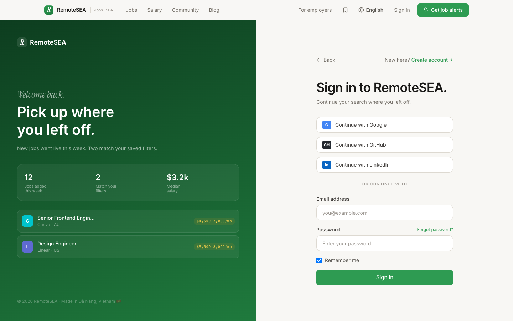

### S1-REGISTER — Đăng ký tài khoản

| Thuộc tính         | Giá trị                                                                                |
| ------------------ | -------------------------------------------------------------------------------------- |
| Sprint             | 1                                                                                      |
| PB                 | PB01 (Đăng ký tài khoản) PB04 (Đăng nhập bằng Google, GitHub hoặc LinkedIn (OAuth)) |
| Actor chụp         | guest                                                                                  |
| Route              | `/register` (đã mở: `/register`)                                                       |
| Điều kiện truy cập | Chỉ khách (GuestOnlyRoute)                                                             |
| Component          | src/features/auth/pages/RegisterPage.tsx → components/RegisterForm.tsx                 |
| Trạng thái chụp    | `OK` → UI status `CAPTURED_AND_VERIFIED`                                               |
| Mức bằng chứng     | Runtime                                                                                |
| DOM đo được        | 3 input · 1 form · 0 bảng · 7 link                                                     |

**Mục đích.** Tạo tài khoản mới với vai trò Ứng viên (Find remote work) hoặc Nhà tuyển dụng (Hire remote talent).

**Điều hướng.** Từ nút primary 'Get job alerts' trên navbar (trỏ tới /register), link 'Create account' ở trang Đăng nhập.

**Bố cục.** Cùng khung 2 cột với trang Đăng nhập. Cột phải: chỉ báo tiến trình '1 of 2 · Your account', H1 'Join RemoteSEA.', cặp nút chọn vai trò (PillToggle), 3 nút OAuth, các trường Full name / Email / Password, nút 'Create account'. Panel trái: tiêu đề serif-italic '500+ talent', trích dẫn người dùng.

**Hành vi đã quan sát.** Chọn 'Hire remote talent' đổi trạng thái nút vai trò (viền + nền brand-50). Gửi rỗng → 'Name is required', 'Email is required', 'Password must be at least 8 characters'.

**Hạn chế / chưa xác minh.** Không gửi form thật (sẽ tạo tài khoản). Trạng thái 'email đã tồn tại' (AC 4.1) cần API — chưa chụp.

Tiêu đề đo được trên trang (1)

- H1: Join RemoteSEA.

| Trạng thái UI                  | Viewport            | Ảnh                                                                                                                  |
| ------------------------------ | ------------------- | -------------------------------------------------------------------------------------------------------------------- |
| Viewport desktop 1440×900      | desktop             | [PB01-guest-auth-register-desktop.png](screenshots/sprint-01/PB01-guest-auth-register-desktop.png)                   |
| Toàn trang desktop             | desktop (full page) | [PB01-guest-auth-register-desktop-full.png](screenshots/sprint-01/PB01-guest-auth-register-desktop-full.png)         |
| Gửi form rỗng → lỗi validation | desktop             | [PB01-guest-auth-register-validation-error.png](screenshots/sprint-01/PB01-guest-auth-register-validation-error.png) |
| Chọn vai trò Nhà tuyển dụng    | desktop             | [PB01-guest-auth-register-employer-role.png](screenshots/sprint-01/PB01-guest-auth-register-employer-role.png)       |
| Viewport mobile 390×844        | mobile              | [PB01-guest-auth-register-mobile.png](screenshots/sprint-01/PB01-guest-auth-register-mobile.png)                     |
| Toàn trang mobile              | mobile (full page)  | [PB01-guest-auth-register-mobile-full.png](screenshots/sprint-01/PB01-guest-auth-register-mobile-full.png)           |

### S1-FORGOT — Quên mật khẩu

| Thuộc tính         | Giá trị                                                                 |
| ------------------ | ----------------------------------------------------------------------- |
| Sprint             | 1                                                                       |
| PB                 | PB06 (Yêu cầu quên mật khẩu)                                            |
| Actor chụp         | guest                                                                   |
| Route              | `/forgot-password` (đã mở: `/forgot-password`)                          |
| Điều kiện truy cập | Chỉ khách                                                               |
| Component          | src/features/auth/pages/ForgotPasswordPage.tsx → ForgotPasswordForm.tsx |
| Trạng thái chụp    | `OK` → UI status `CAPTURED_AND_VERIFIED`                                |
| Mức bằng chứng     | Runtime                                                                 |
| DOM đo được        | 1 input · 1 form · 0 bảng · 1 link                                      |

**Mục đích.** Yêu cầu gửi liên kết đặt lại mật khẩu qua email.

**Điều hướng.** Link 'Forgot password?' trên form đăng nhập.

**Bố cục.** Form một cột: tiêu đề, mô tả, trường Email, nút 'Send reset link', link quay lại đăng nhập.

**Hành vi đã quan sát.** Gửi rỗng → lỗi validation email.

**Hạn chế / chưa xác minh.** Không gửi yêu cầu thật (sẽ gửi email). Trạng thái thành công 'đã gửi' chưa chụp.

Tiêu đề đo được trên trang (1)

- H1: Reset your password

| Trạng thái UI                  | Viewport            | Ảnh                                                                                                                                |
| ------------------------------ | ------------------- | ---------------------------------------------------------------------------------------------------------------------------------- |
| Viewport desktop 1440×900      | desktop             | [PB06-guest-auth-forgot-password-desktop.png](screenshots/sprint-01/PB06-guest-auth-forgot-password-desktop.png)                   |
| Toàn trang desktop             | desktop (full page) | [PB06-guest-auth-forgot-password-desktop-full.png](screenshots/sprint-01/PB06-guest-auth-forgot-password-desktop-full.png)         |
| Gửi form rỗng → lỗi validation | desktop             | [PB06-guest-auth-forgot-password-validation-error.png](screenshots/sprint-01/PB06-guest-auth-forgot-password-validation-error.png) |

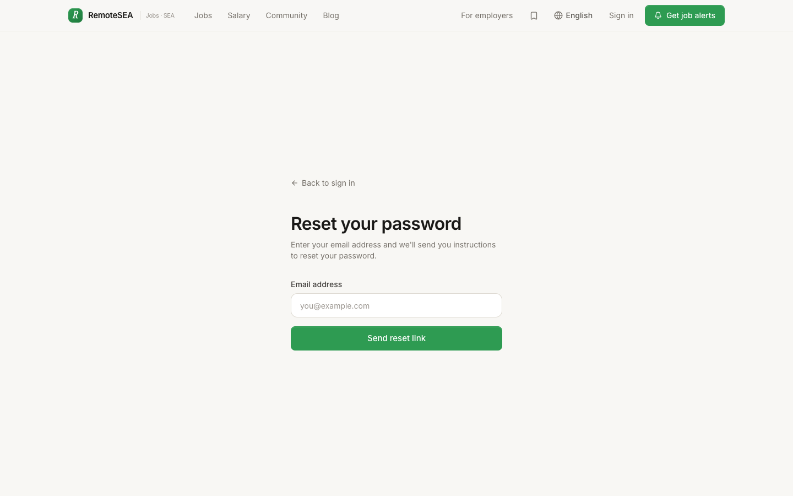

### S1-RESET — Đặt lại mật khẩu (thiếu token)

| Thuộc tính         | Giá trị                                                               |
| ------------------ | --------------------------------------------------------------------- |
| Sprint             | 1                                                                     |
| PB                 | PB07 (Đặt lại mật khẩu qua email)                                     |
| Actor chụp         | guest                                                                 |
| Route              | `/reset-password` (đã mở: `/reset-password`)                          |
| Điều kiện truy cập | Chỉ khách; cần ?token= từ email                                       |
| Component          | src/features/auth/pages/ResetPasswordPage.tsx → ResetPasswordForm.tsx |
| Trạng thái chụp    | `OK` → UI status `CAPTURED_AND_VERIFIED`                              |
| Mức bằng chứng     | Runtime                                                               |
| DOM đo được        | 0 input · 0 form · 0 bảng · 1 link                                    |

**Mục đích.** Đặt mật khẩu mới từ liên kết trong email.

**Điều hướng.** Chỉ đi vào từ liên kết email (không có trên menu).

**Bố cục.** Khung form hẹp căn giữa: link 'Back to sign in', H1 'Choose a new password', mô tả yêu cầu ≥ 8 ký tự. Không có token: hộp lỗi nền danger-50 'This reset link is invalid or missing its token. Request a new one.' thay cho form. Có token: hiện form mật khẩu mới.

**Hành vi đã quan sát.** Ảnh 'with-token' dùng token giả chỉ để hiển thị form; không gửi.

**Hạn chế / chưa xác minh.** Không có token thật nên không xác minh luồng đặt lại thành công / token hết hạn.

Tiêu đề đo được trên trang (1)

- H1: Choose a new password

| Trạng thái UI                          | Viewport            | Ảnh                                                                                                                      |
| -------------------------------------- | ------------------- | ------------------------------------------------------------------------------------------------------------------------ |
| Viewport desktop 1440×900              | desktop             | [PB07-guest-auth-reset-password-desktop.png](screenshots/sprint-01/PB07-guest-auth-reset-password-desktop.png)           |
| Toàn trang desktop                     | desktop (full page) | [PB07-guest-auth-reset-password-desktop-full.png](screenshots/sprint-01/PB07-guest-auth-reset-password-desktop-full.png) |
| Có tham số token (giả) → hiển thị form | desktop             | [PB07-guest-auth-reset-password-with-token.png](screenshots/sprint-01/PB07-guest-auth-reset-password-with-token.png)     |

### S1-OAUTH-CALLBACK — OAuth callback (không có mã)

| Thuộc tính         | Giá trị                                                    |
| ------------------ | ---------------------------------------------------------- |
| Sprint             | 1                                                          |
| PB                 | PB04 (Đăng nhập bằng Google, GitHub hoặc LinkedIn (OAuth)) |
| Actor chụp         | guest                                                      |
| Route              | `/auth/callback` (đã mở: `/auth/callback` → `/login`)      |
| Điều kiện truy cập | Công khai — đích chuyển hướng của nhà cung cấp OAuth       |
| Component          | src/features/auth/pages/AuthCallbackPage.tsx               |
| Trạng thái chụp    | `UNEXPECTED_REDIRECT` → UI status `NOT_VERIFIED`           |
| Mức bằng chứng     | Runtime                                                    |
| DOM đo được        | 3 input · 1 form · 0 bảng · 6 link                         |

**Mục đích.** Nhận mã từ nhà cung cấp OAuth, đổi lấy phiên đăng nhập (POST /auth/oauth/exchange).

**Điều hướng.** Không có trên menu; chỉ được nhà cung cấp OAuth gọi về.

**Hành vi đã quan sát.** Mở trực tiếp không có mã → không có trang riêng: ứng dụng chuyển về /login và hiện toast lỗi 'Sign in failed — Missing authentication code.' (góc dưới phải). Việc chuyển hướng này là hành vi đúng của trang, không phải lỗi chụp.

**Hạn chế / chưa xác minh.** Luồng thành công cần đăng nhập Google/GitHub/LinkedIn thật — không thực hiện.

Tiêu đề đo được trên trang (1)

- H1: Sign in to RemoteSEA.

| Trạng thái UI             | Viewport            | Ảnh                                                                                                                      |
| ------------------------- | ------------------- | ------------------------------------------------------------------------------------------------------------------------ |
| Viewport desktop 1440×900 | desktop             | [PB04-guest-auth-oauth-callback-desktop.png](screenshots/sprint-01/PB04-guest-auth-oauth-callback-desktop.png)           |
| Toàn trang desktop        | desktop (full page) | [PB04-guest-auth-oauth-callback-desktop-full.png](screenshots/sprint-01/PB04-guest-auth-oauth-callback-desktop-full.png) |

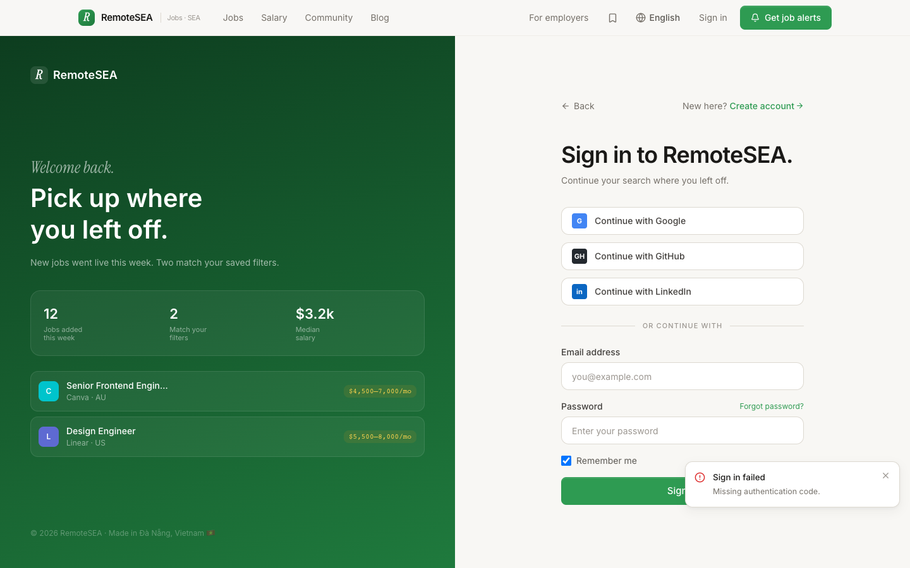

### S1-TALENT-VERIFY — Xác minh email ứng viên (không có token)

| Thuộc tính         | Giá trị                                            |
| ------------------ | -------------------------------------------------- |
| Sprint             | 1                                                  |
| PB                 | PB22 (Xác minh email ứng viên)                     |
| Actor chụp         | guest                                              |
| Route              | `/talent/verify` (đã mở: `/talent/verify`)         |
| Điều kiện truy cập | Công khai — liên kết trong email xác minh          |
| Component          | src/features/talent/pages/TalentVerifyPage.tsx     |
| Trạng thái chụp    | `OK` → UI status `CAPTURED_NOT_INTERACTION_TESTED` |
| Mức bằng chứng     | Runtime                                            |
| DOM đo được        | 0 input · 0 form · 0 bảng · 1 link                 |

**Mục đích.** Xác nhận email ứng viên bằng token (POST /talent/verification/confirm).

**Điều hướng.** Liên kết trong email; banner 'Verify email' trên dashboard ứng viên gửi email này.

**Bố cục.** Trạng thái kết quả căn giữa: icon tròn (đỏ khi lỗi), tiêu đề, mô tả, nút primary.

**Hành vi đã quan sát.** Không có token → 'Link expired or invalid — Request a new verification email from your dashboard.' + nút 'Go to dashboard'.

**Hạn chế / chưa xác minh.** Không xác minh luồng thành công (cần email thật).

Tiêu đề đo được trên trang (1)

- H1: Link expired or invalid

| Trạng thái UI             | Viewport            | Ảnh                                                                                                                      |
| ------------------------- | ------------------- | ------------------------------------------------------------------------------------------------------------------------ |
| Viewport desktop 1440×900 | desktop             | [PB22-guest-talent-email-verify-desktop.png](screenshots/sprint-01/PB22-guest-talent-email-verify-desktop.png)           |
| Toàn trang desktop        | desktop (full page) | [PB22-guest-talent-email-verify-desktop-full.png](screenshots/sprint-01/PB22-guest-talent-email-verify-desktop-full.png) |

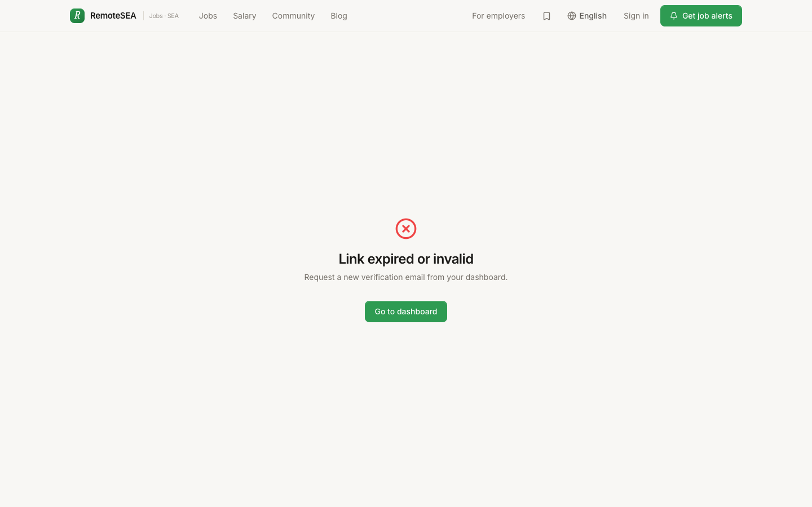

### S1-AUTH-GUARD — Truy cập trang cần đăng nhập → chuyển về /login

| Thuộc tính         | Giá trị                                                                     |
| ------------------ | --------------------------------------------------------------------------- |
| Sprint             | 1                                                                           |
| PB                 | PB08 (Xem trạng thái phiên đăng nhập)                                       |
| Actor chụp         | guest                                                                       |
| Route              | `/settings (guest)` (đã mở: `/settings` → `/login?callbackUrl=%2Fsettings`) |
| Điều kiện truy cập | Khách mở route cần đăng nhập                                                |
| Component          | src/router/ProtectedRoute.tsx                                               |
| Trạng thái chụp    | `REDIRECT_AS_EXPECTED` → UI status `CAPTURED_NOT_INTERACTION_TESTED`        |
| Mức bằng chứng     | Runtime                                                                     |
| DOM đo được        | 3 input · 1 form · 0 bảng · 6 link                                          |

**Mục đích.** Bằng chứng cho cơ chế kiểm tra phiên: route được bảo vệ chuyển khách về /login?callbackUrl=… thay vì hiển thị nội dung.

**Hành vi đã quan sát.** Mở /settings khi chưa đăng nhập → URL cuối là /login?callbackUrl=%2Fsettings. Nếu không xác nhận được phiên do lỗi mạng/5xx, ProtectedRoute hiển thị màn hình 'thử lại' thay vì đá ra đăng nhập (đọc từ source, chưa tái hiện).

Tiêu đề đo được trên trang (1)

- H1: Sign in to RemoteSEA.

| Trạng thái UI             | Viewport            | Ảnh                                                                                                                              |
| ------------------------- | ------------------- | -------------------------------------------------------------------------------------------------------------------------------- |
| Viewport desktop 1440×900 | desktop             | [PB08-guest-auth-protected-redirect-desktop.png](screenshots/sprint-01/PB08-guest-auth-protected-redirect-desktop.png)           |
| Toàn trang desktop        | desktop (full page) | [PB08-guest-auth-protected-redirect-desktop-full.png](screenshots/sprint-01/PB08-guest-auth-protected-redirect-desktop-full.png) |

### S1-SPRINT-BOARD — Sprint Board (công cụ nội bộ kiểm thử)

| Thuộc tính         | Giá trị                                                                                                 |
| ------------------ | ------------------------------------------------------------------------------------------------------- |
| Sprint             | 1                                                                                                       |
| PB                 | UNMAPPED                                                                                                |
| Actor chụp         | guest                                                                                                   |
| Route              | `/sprints` (đã mở: `/sprints`)                                                                          |
| Điều kiện truy cập | Chỉ khi import.meta.env.DEV hoặc VITE_ENABLE_SPRINT_BOARD=true                                          |
| Component          | src/features/sprints/pages/SprintBoardPage.tsx (dữ liệu sinh từ docs/ bởi scripts/generate-sprints.mjs) |
| Trạng thái chụp    | `OK` → UI status `IMPLEMENTED_BUT_UNMAPPED`                                                             |
| Mức bằng chứng     | Runtime                                                                                                 |
| DOM đo được        | 0 input · 0 form · 0 bảng · 0 link                                                                      |

**Mục đích.** Công cụ nội bộ phục vụ kiểm thử: liệt kê Sprint và PB theo Product Backlog. Không phải tính năng người dùng cuối.

**Hạn chế / chưa xác minh.** Không thuộc PB nào — ghi UNMAPPED. sprint-routes.ts gán route này cho Sprint 1.

Tiêu đề đo được trên trang (5)

- H1: Sprint 1
- H2: Product backlog items
- H1: Sprint 2
- H1: Sprint 3
- H1: Sprint 4

| Trạng thái UI             | Viewport            | Ảnh                                                                                                                                  |
| ------------------------- | ------------------- | ------------------------------------------------------------------------------------------------------------------------------------ |
| Viewport desktop 1440×900 | desktop             | [UNMAPPED-guest-internal-sprint-board-desktop.png](screenshots/sprint-01/UNMAPPED-guest-internal-sprint-board-desktop.png)           |
| Toàn trang desktop        | desktop (full page) | [UNMAPPED-guest-internal-sprint-board-desktop-full.png](screenshots/sprint-01/UNMAPPED-guest-internal-sprint-board-desktop-full.png) |

### S1-SETTINGS — Cài đặt tài khoản

| Thuộc tính         | Giá trị                                                                                                                                                                                                                                                                                                                                                                                                                                                                                                                                       |
| ------------------ | --------------------------------------------------------------------------------------------------------------------------------------------------------------------------------------------------------------------------------------------------------------------------------------------------------------------------------------------------------------------------------------------------------------------------------------------------------------------------------------------------------------------------------------------- |
| Sprint             | 1                                                                                                                                                                                                                                                                                                                                                                                                                                                                                                                                             |
| PB                 | PB12 (Đổi mật khẩu tài khoản) PB05 (Liên kết tài khoản đăng nhập mạng xã hội) PB10 (Bật xác thực hai lớp (2FA Setup & Verify)) PB11 (Tắt xác thực hai lớp) PB13 (Cập nhật tên hiển thị) PB14 (Cập nhật thông tin tài khoản cá nhân) PB15 (Cấu hình tùy chọn nhận thông báo) PB16 (Tạm dừng hoặc kích hoạt lại tài khoản) PB17 (Xuất dữ liệu cá nhân (Export Personal Data)) PB18 (Quản lý các tài khoản xã hội đã liên kết) PB19 (Quản lý các phiên đăng nhập đang hoạt động) PB20 (Xóa vĩnh viễn tài khoản) |
| Actor chụp         | talent                                                                                                                                                                                                                                                                                                                                                                                                                                                                                                                                        |
| Route              | `/settings` (đã mở: `/settings`)                                                                                                                                                                                                                                                                                                                                                                                                                                                                                                              |
| Điều kiện truy cập | —                                                                                                                                                                                                                                                                                                                                                                                                                                                                                                                                             |
| Component          | —                                                                                                                                                                                                                                                                                                                                                                                                                                                                                                                                             |
| Trạng thái chụp    | `OK` → UI status `PARTIALLY_CAPTURED`                                                                                                                                                                                                                                                                                                                                                                                                                                                                                                         |
| Mức bằng chứng     | Runtime                                                                                                                                                                                                                                                                                                                                                                                                                                                                                                                                       |
| Lỗi API khi chụp   | GET /notifications -> 500                                                                                                                                                                                                                                                                                                                                                                                                                                                                                                                     |
| DOM đo được        | 7 input · 1 form · 0 bảng · 5 link                                                                                                                                                                                                                                                                                                                                                                                                                                                                                                            |

Tiêu đề đo được trên trang (7)

- H1: Your account, your rules.
- H2: Your account .
- H2: Security.
- H2: Connected accounts.
- H2: Notifications.
- H2: Privacy & data.
- H2: Danger zone.

| Trạng thái UI                                  | Viewport            | Ảnh                                                                                                                                                                |
| ---------------------------------------------- | ------------------- | ------------------------------------------------------------------------------------------------------------------------------------------------------------------ |
| Viewport desktop 1440×900                      | desktop             | [PB12-talent-settings-account-settings-desktop.png](screenshots/sprint-01/PB12-talent-settings-account-settings-desktop.png)                                       |
| Toàn trang desktop                             | desktop (full page) | [PB12-talent-settings-account-settings-desktop-full.png](screenshots/sprint-01/PB12-talent-settings-account-settings-desktop-full.png)                             |
| Mục Bảo mật (mật khẩu, 2FA, phiên đăng nhập)   | desktop             | [PB12-talent-settings-account-settings-security.png](screenshots/sprint-01/PB12-talent-settings-account-settings-security.png)                                     |
| Mục Tài khoản liên kết (OAuth)                 | desktop             | [PB12-talent-settings-account-settings-connected.png](screenshots/sprint-01/PB12-talent-settings-account-settings-connected.png)                                   |
| Mục Tuỳ chọn thông báo                         | desktop             | [PB12-talent-settings-account-settings-notifications.png](screenshots/sprint-01/PB12-talent-settings-account-settings-notifications.png)                           |
| Mục Quyền riêng tư & dữ liệu                   | desktop             | [PB12-talent-settings-account-settings-privacy.png](screenshots/sprint-01/PB12-talent-settings-account-settings-privacy.png)                                       |
| Vùng nguy hiểm (tạm dừng / xoá tài khoản)      | desktop             | [PB12-talent-settings-account-settings-danger-zone.png](screenshots/sprint-01/PB12-talent-settings-account-settings-danger-zone.png)                               |
| Form đổi mật khẩu gửi rỗng → lỗi validation    | desktop             | [PB12-talent-settings-account-settings-change-password-validation.png](screenshots/sprint-01/PB12-talent-settings-account-settings-change-password-validation.png) |
| Mở hộp xác nhận xoá tài khoản (không xác nhận) | desktop             | [PB12-talent-settings-account-settings-delete-confirm.png](screenshots/sprint-01/PB12-talent-settings-account-settings-delete-confirm.png)                         |
| Mở menu chọn ngôn ngữ trên navbar              | desktop             | [PB12-talent-settings-account-settings-language-menu.png](screenshots/sprint-01/PB12-talent-settings-account-settings-language-menu.png)                           |
| Viewport mobile 390×844                        | mobile              | [PB12-talent-settings-account-settings-mobile.png](screenshots/sprint-01/PB12-talent-settings-account-settings-mobile.png)                                         |
| Toàn trang mobile                              | mobile (full page)  | [PB12-talent-settings-account-settings-mobile-full.png](screenshots/sprint-01/PB12-talent-settings-account-settings-mobile-full.png)                               |

### S1-PROFILE — Tạo / cập nhật hồ sơ ứng viên

| Thuộc tính         | Giá trị                                                                                                                                                                                                                                                                  |
| ------------------ | ------------------------------------------------------------------------------------------------------------------------------------------------------------------------------------------------------------------------------------------------------------------------ |
| Sprint             | 1                                                                                                                                                                                                                                                                        |
| PB                 | PB21 (Tạo và cập nhật hồ sơ ứng viên) PB23 (Thiết lập chế độ hiển thị hồ sơ ứng viên) PB24 (Quản lý kinh nghiệm làm việc của ứng viên) PB25 (Quản lý điểm nhấn hồ sơ, portfolio, học vấn, ngôn ngữ) PB52 (Tìm kiếm và gợi ý kỹ năng chuẩn (Skills Taxonomy)) |
| Actor chụp         | talent                                                                                                                                                                                                                                                                   |
| Route              | `/profile` (đã mở: `/profile`)                                                                                                                                                                                                                                           |
| Điều kiện truy cập | —                                                                                                                                                                                                                                                                        |
| Component          | —                                                                                                                                                                                                                                                                        |
| Trạng thái chụp    | `OK` → UI status `CAPTURED_AND_VERIFIED`                                                                                                                                                                                                                                 |
| Mức bằng chứng     | Runtime                                                                                                                                                                                                                                                                  |
| DOM đo được        | 18 input · 1 form · 0 bảng · 4 link                                                                                                                                                                                                                                      |

Tiêu đề đo được trên trang (12)

- H1: Make sure recruiters see what matters.
- H2: The basics.
- H2: About you.
- H2: Experience.
- H2: Skills.
- H2: Job preferences.
- H2: Links & CV.
- H2: Highlights.
- H3: Selected work
- H3: Education
- H3: Languages
- H2: Visibility.

| Trạng thái UI                                         | Viewport            | Ảnh                                                                                                                                                                      |
| ----------------------------------------------------- | ------------------- | ------------------------------------------------------------------------------------------------------------------------------------------------------------------------ |
| Viewport desktop 1440×900                             | desktop             | [PB21-talent-talent-profile-profile-editor-desktop.png](screenshots/sprint-01/PB21-talent-talent-profile-profile-editor-desktop.png)                                     |
| Toàn trang desktop                                    | desktop (full page) | [PB21-talent-talent-profile-profile-editor-desktop-full.png](screenshots/sprint-01/PB21-talent-talent-profile-profile-editor-desktop-full.png)                           |
| Mục Kinh nghiệm làm việc (PB24)                       | desktop             | [PB21-talent-talent-profile-profile-editor-experience.png](screenshots/sprint-01/PB21-talent-talent-profile-profile-editor-experience.png)                               |
| Mục Kỹ năng — gợi ý kỹ năng chuẩn (PB52)              | desktop             | [PB21-talent-talent-profile-profile-editor-skills.png](screenshots/sprint-01/PB21-talent-talent-profile-profile-editor-skills.png)                                       |
| Mục Điểm nhấn / portfolio / học vấn / ngôn ngữ (PB25) | desktop             | [PB21-talent-talent-profile-profile-editor-highlights.png](screenshots/sprint-01/PB21-talent-talent-profile-profile-editor-highlights.png)                               |
| Mục Chế độ hiển thị hồ sơ (PB23)                      | desktop             | [PB21-talent-talent-profile-profile-editor-visibility.png](screenshots/sprint-01/PB21-talent-talent-profile-profile-editor-visibility.png)                               |
| Mở form thêm kinh nghiệm làm việc                     | desktop             | [PB21-talent-talent-profile-profile-editor-add-experience-form.png](screenshots/sprint-01/PB21-talent-talent-profile-profile-editor-add-experience-form.png)             |
| Form kinh nghiệm gửi rỗng → lỗi validation            | desktop             | [PB21-talent-talent-profile-profile-editor-add-experience-validation.png](screenshots/sprint-01/PB21-talent-talent-profile-profile-editor-add-experience-validation.png) |
| Viewport mobile 390×844                               | mobile              | [PB21-talent-talent-profile-profile-editor-mobile.png](screenshots/sprint-01/PB21-talent-talent-profile-profile-editor-mobile.png)                                       |
| Toàn trang mobile                                     | mobile (full page)  | [PB21-talent-talent-profile-profile-editor-mobile-full.png](screenshots/sprint-01/PB21-talent-talent-profile-profile-editor-mobile-full.png)                             |

### S1-LOGOUT — Đăng xuất (hộp xác nhận trên navbar)

| Thuộc tính         | Giá trị                                                     |
| ------------------ | ----------------------------------------------------------- |
| Sprint             | 1                                                           |
| PB                 | PB09 (Đăng xuất khỏi hệ thống)                              |
| Actor chụp         | talent                                                      |
| Route              | `(navbar, mọi trang)` (đã mở: `/jobs`)                      |
| Điều kiện truy cập | —                                                           |
| Component          | —                                                           |
| Trạng thái chụp    | `OK` → UI status `CAPTURED_AND_VERIFIED` (đã thử lại 1 lần) |
| Mức bằng chứng     | Runtime                                                     |
| DOM đo được        | 19 input · 0 form · 0 bảng · 18 link                        |

Tiêu đề đo được trên trang (9)

- H1: Jobs
- H3: Filters
- H3: Machine Learning Engineer
- H3: Marketing Operations Manager
- H3: Product Designer
- H3: Performance Marketing Specialist
- H3: Data Engineer
- H3: Business Intelligence Analyst
- H3: Design Systems Lead

| Trạng thái UI                                  | Viewport            | Ảnh                                                                                                                |
| ---------------------------------------------- | ------------------- | ------------------------------------------------------------------------------------------------------------------ |
| Viewport desktop 1440×900                      | desktop             | [PB09-talent-auth-sign-out-desktop.png](screenshots/sprint-01/PB09-talent-auth-sign-out-desktop.png)               |
| Toàn trang desktop                             | desktop (full page) | [PB09-talent-auth-sign-out-desktop-full.png](screenshots/sprint-01/PB09-talent-auth-sign-out-desktop-full.png)     |
| Bấm 'Sign out' → hộp xác nhận (không xác nhận) | desktop             | [PB09-talent-auth-sign-out-confirm-dialog.png](screenshots/sprint-01/PB09-talent-auth-sign-out-confirm-dialog.png) |

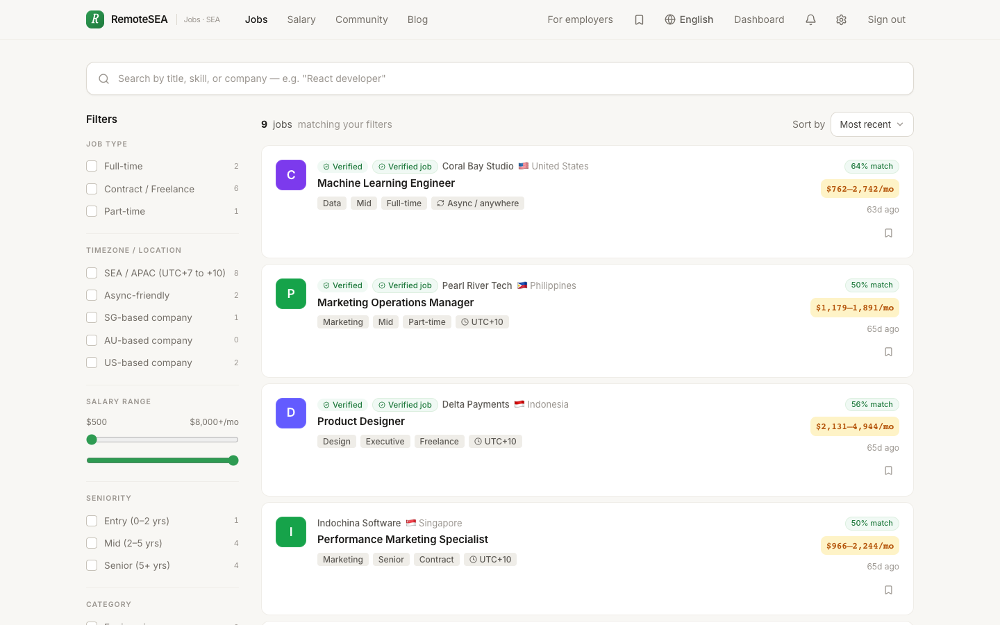

## Sprint 2 — Hồ sơ ứng viên, Doanh nghiệp & Tin tuyển dụng

### S2-JOBS — Tìm kiếm & lọc việc làm

| Thuộc tính         | Giá trị                                                                                                                                |
| ------------------ | -------------------------------------------------------------------------------------------------------------------------------------- |
| Sprint             | 2                                                                                                                                      |
| PB                 | PB47 (Tìm kiếm và lọc tin tuyển dụng) PB49 (Lưu hoặc bỏ lưu tin tuyển dụng) PB51 (Xem danh mục ngành nghề (Taxonomy Categories)) |
| Actor chụp         | guest                                                                                                                                  |
| Route              | `/jobs` (đã mở: `/jobs`)                                                                                                               |
| Điều kiện truy cập | Công khai                                                                                                                              |
| Component          | src/features/jobs/pages/JobsPage.tsx → components/JobsBoard.tsx, SearchBar.tsx, FilterSidebar.tsx, JobCard.tsx, Pagination.tsx         |
| Trạng thái chụp    | `OK` → UI status `PARTIALLY_CAPTURED`                                                                                                  |
| Mức bằng chứng     | Runtime                                                                                                                                |
| Lỗi API khi chụp   | GET /categories -> 500, GET /jobs -> 500                                                                                               |
| DOM đo được        | 19 input · 0 form · 0 bảng · 18 link                                                                                                   |

**Mục đích.** Tìm kiếm và lọc tin tuyển dụng remote theo từ khoá, loại hình, múi giờ/khu vực, dải lương, cấp bậc, ngành nghề; sắp xếp kết quả.

**Điều hướng.** Link 'Jobs' trên navbar; trang mặc định sau khi ứng viên đăng nhập. Trạng thái lọc được giữ trên URL (?q=, type=, tz=, level=, category=, salaryMin/Max, sort=, page=).

**Bố cục.** Thanh tìm kiếm toàn chiều rộng; sidebar 'Filters' bên trái (nhóm JOB TYPE, TIMEZONE / LOCATION, SALARY RANGE với thanh trượt kép, SENIORITY, CATEGORY — mỗi lựa chọn có số đếm facet); vùng kết quả bên phải với tổng số, dropdown 'Sort by'; danh sách JobCard (logo chữ cái, badge Verified/Verified job, công ty + quốc gia, tiêu đề, tag ngành/cấp bậc/loại hình/múi giờ, SalaryBadge màu amber, thời gian đăng, nút lưu). Mobile: sidebar thu thành nút 'Filters' mở/đóng.

**Hành vi đã quan sát.** Đã kiểm tra: tìm 'engineer', lọc Full-time + Senior + sắp theo lương (qua URL), từ khoá không có kết quả → empty state, mở bộ lọc trên mobile. Dữ liệu thật: 9 tin đang mở.

**Hạn chế / chưa xác minh.** Chỉ có 9 tin (limit 20/trang) nên không tái hiện được trạng thái phân trang nhiều trang. Lọc 'Quốc gia' trong AC PB47 được thể hiện qua nhóm Timezone/Location, không có bộ lọc quốc gia riêng.

Tiêu đề đo được trên trang (9)

- H1: Jobs
- H3: Filters
- H3: Machine Learning Engineer
- H3: Marketing Operations Manager
- H3: Product Designer
- H3: Performance Marketing Specialist
- H3: Data Engineer
- H3: Business Intelligence Analyst
- H3: Design Systems Lead

| Trạng thái UI                              | Viewport            | Ảnh                                                                                                                |
| ------------------------------------------ | ------------------- | ------------------------------------------------------------------------------------------------------------------ |
| Viewport desktop 1440×900                  | desktop             | [PB47-guest-jobs-job-board-desktop.png](screenshots/sprint-02/PB47-guest-jobs-job-board-desktop.png)               |
| Toàn trang desktop                         | desktop (full page) | [PB47-guest-jobs-job-board-desktop-full.png](screenshots/sprint-02/PB47-guest-jobs-job-board-desktop-full.png)     |
| Tìm kiếm theo từ khoá 'engineer'           | desktop             | [PB47-guest-jobs-job-board-search.png](screenshots/sprint-02/PB47-guest-jobs-job-board-search.png)                 |
| Lọc Full-time + Senior, sắp xếp theo lương | desktop             | [PB47-guest-jobs-job-board-filtered.png](screenshots/sprint-02/PB47-guest-jobs-job-board-filtered.png)             |
| Không có kết quả (empty state)             | desktop             | [PB47-guest-jobs-job-board-empty-result.png](screenshots/sprint-02/PB47-guest-jobs-job-board-empty-result.png)     |
| Mở bộ lọc trên mobile                      | mobile              | [PB47-guest-jobs-job-board-mobile-filters.png](screenshots/sprint-02/PB47-guest-jobs-job-board-mobile-filters.png) |
| Viewport mobile 390×844                    | mobile              | [PB47-guest-jobs-job-board-mobile.png](screenshots/sprint-02/PB47-guest-jobs-job-board-mobile.png)                 |
| Toàn trang mobile                          | mobile (full page)  | [PB47-guest-jobs-job-board-mobile-full.png](screenshots/sprint-02/PB47-guest-jobs-job-board-mobile-full.png)       |

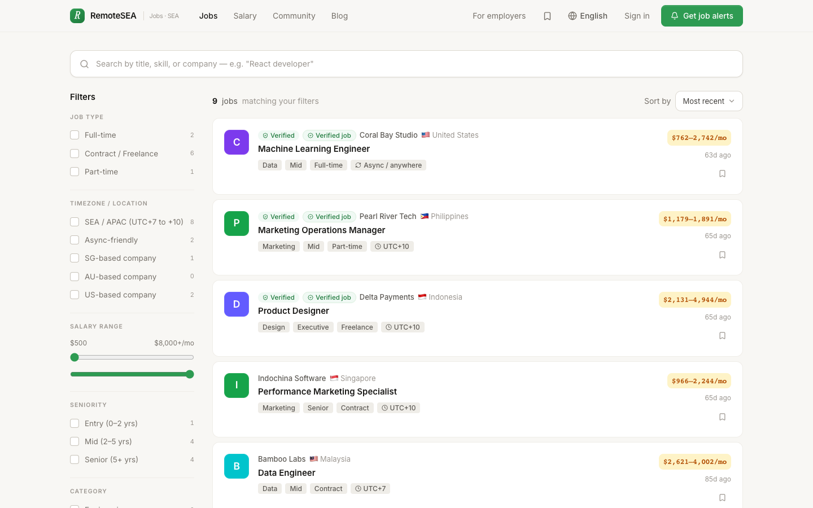

### S2-JOB-DETAIL — Chi tiết tin tuyển dụng (khách)

| Thuộc tính         | Giá trị                                                                                                                                                                                                                          |
| ------------------ | -------------------------------------------------------------------------------------------------------------------------------------------------------------------------------------------------------------------------------- |
| Sprint             | 2                                                                                                                                                                                                                                |
| PB                 | PB48 (Xem chi tiết tin tuyển dụng) PB82 (Xem thông tin tham khảo mức lương (Salary Insights))                                                                                                                                 |
| Actor chụp         | guest                                                                                                                                                                                                                            |
| Route              | `/jobs/:id` (đã mở: `/jobs/cmrxb4i6v007ce9zeq0fw2kg7`)                                                                                                                                                                           |
| Điều kiện truy cập | Công khai (một số khối chỉ hiện khi đăng nhập)                                                                                                                                                                                   |
| Component          | src/features/jobs/pages/JobDetailPage.tsx → job-detail/JobHeaderCard, JobDescriptionCard, JobSkillsCard, JobBenefitsCard, ApplyCard, SalaryBenchmarkCard, QuickFactsCard, JobCompanyCard, VnSignalCard, MatchCard, ReportJobForm |
| Trạng thái chụp    | `OK` → UI status `CAPTURED_AND_VERIFIED`                                                                                                                                                                                         |
| Mức bằng chứng     | Runtime                                                                                                                                                                                                                          |
| DOM đo được        | 0 input · 0 form · 0 bảng · 0 link                                                                                                                                                                                               |

**Mục đích.** Xem đầy đủ thông tin tin tuyển dụng trước khi ứng tuyển.

**Điều hướng.** Bấm JobCard ở /jobs, trang công ty, gợi ý trên dashboard; 'Back to jobs'.

**Bố cục.** 2 cột: trái gồm thẻ tiêu đề (logo, Verified employer, quốc gia, tiêu đề, công ty, tag, SalaryBadge, thời gian đăng), 'About the role', 'Skills & technologies', 'Benefits'; phải gồm thẻ ứng tuyển (mức lương lớn, 'Apply now', 'Save for later', số người đã ứng tuyển), 'Salary check' (so sánh với thị trường — PB82), 'Quick facts'.

**Hành vi đã quan sát.** Khách bấm 'Apply now' → chuyển tới /login (đã xác minh).

**Hạn chế / chưa xác minh.** Khối Match Score (PB50) và form ứng tuyển chỉ có khi đăng nhập — xem S2-JOB-DETAIL-TALENT.

| Trạng thái UI                              | Viewport            | Ảnh                                                                                                                  |
| ------------------------------------------ | ------------------- | -------------------------------------------------------------------------------------------------------------------- |
| Viewport desktop 1440×900                  | desktop             | [PB48-guest-jobs-job-detail-desktop.png](screenshots/sprint-02/PB48-guest-jobs-job-detail-desktop.png)               |
| Toàn trang desktop                         | desktop (full page) | [PB48-guest-jobs-job-detail-desktop-full.png](screenshots/sprint-02/PB48-guest-jobs-job-detail-desktop-full.png)     |
| Khách bấm Ứng tuyển → chuyển tới đăng nhập | desktop             | [PB48-guest-jobs-job-detail-apply-as-guest.png](screenshots/sprint-02/PB48-guest-jobs-job-detail-apply-as-guest.png) |
| Viewport mobile 390×844                    | mobile              | [PB48-guest-jobs-job-detail-mobile.png](screenshots/sprint-02/PB48-guest-jobs-job-detail-mobile.png)                 |
| Toàn trang mobile                          | mobile (full page)  | [PB48-guest-jobs-job-detail-mobile-full.png](screenshots/sprint-02/PB48-guest-jobs-job-detail-mobile-full.png)       |

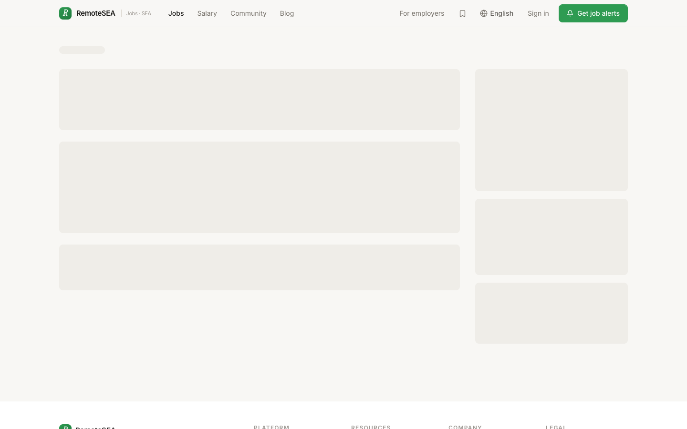

### S2-COMPANY — Hồ sơ công ty công khai

| Thuộc tính         | Giá trị                                                                                            |
| ------------------ | -------------------------------------------------------------------------------------------------- |
| Sprint             | 2                                                                                                  |
| PB                 | PB33 (Xem trang hồ sơ công ty công khai) PB72 (Xem đánh giá công khai của người dùng / công ty) |
| Actor chụp         | guest                                                                                              |
| Route              | `/companies/:slug` (đã mở: `/companies/coral-bay-studio-Vd4CB2`)                                   |
| Điều kiện truy cập | Công khai                                                                                          |
| Component          | src/features/employer/pages/CompanyProfilePage.tsx                                                 |
| Trạng thái chụp    | `OK` → UI status `CAPTURED_NOT_INTERACTION_TESTED`                                                 |
| Mức bằng chứng     | Runtime                                                                                            |
| DOM đo được        | 0 input · 0 form · 0 bảng · 3 link                                                                 |

**Mục đích.** Trang thương hiệu công ty: giới thiệu, thông tin cơ bản, danh sách vị trí đang tuyển.

**Điều hướng.** Tên công ty trên JobCard / chi tiết việc làm.

**Bố cục.** Thẻ đầu trang (logo, tên + badge Verified, mô tả, địa điểm, ngành, quy mô, năm thành lập, link Website); 'Open positions (n)' dùng lại JobCard; sidebar 'Quick facts' (số vị trí, thời gian phản hồi trung bình, ngày xác minh).

**Hạn chế / chưa xác minh.** Khối đánh giá công khai (PB72) chỉ hiện khi công ty có đánh giá — công ty được chụp chưa có.

Tiêu đề đo được trên trang (3)

- H1: Coral Bay Studio
- H2: Open positions (1)
- H3: Machine Learning Engineer

| Trạng thái UI             | Viewport            | Ảnh                                                                                                                            |
| ------------------------- | ------------------- | ------------------------------------------------------------------------------------------------------------------------------ |
| Viewport desktop 1440×900 | desktop             | [PB33-guest-company-public-company-desktop.png](screenshots/sprint-02/PB33-guest-company-public-company-desktop.png)           |
| Toàn trang desktop        | desktop (full page) | [PB33-guest-company-public-company-desktop-full.png](screenshots/sprint-02/PB33-guest-company-public-company-desktop-full.png) |
| Viewport mobile 390×844   | mobile              | [PB33-guest-company-public-company-mobile.png](screenshots/sprint-02/PB33-guest-company-public-company-mobile.png)             |
| Toàn trang mobile         | mobile (full page)  | [PB33-guest-company-public-company-mobile-full.png](screenshots/sprint-02/PB33-guest-company-public-company-mobile-full.png)   |

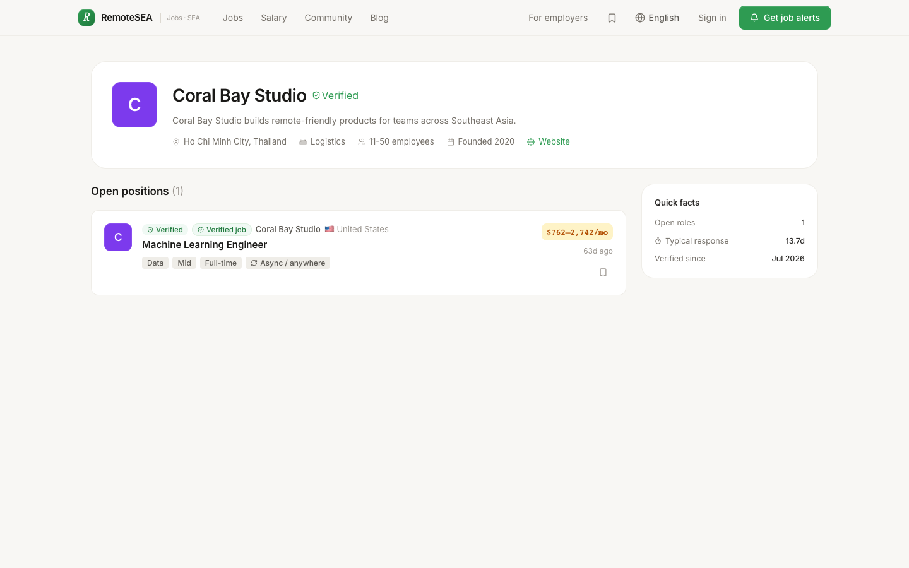

### S2-TALENT-PUBLIC — Hồ sơ công khai ứng viên

| Thuộc tính         | Giá trị                                                                                           |
| ------------------ | ------------------------------------------------------------------------------------------------- |
| Sprint             | 2                                                                                                 |
| PB                 | PB28 (Xem hồ sơ công khai của ứng viên) PB72 (Xem đánh giá công khai của người dùng / công ty) |
| Actor chụp         | guest                                                                                             |
| Route              | `/talent/:slug` (đã mở: `/talent/mai-nguyen-wsYDRb`)                                              |
| Điều kiện truy cập | Công khai nếu hồ sơ đặt PUBLIC; VERIFIED_EMPLOYERS / PRIVATE → khách nhận 404                     |
| Component          | src/features/talent/pages/PublicTalentProfilePage.tsx → public-profile/*                          |
| Trạng thái chụp    | `OK` → UI status `CAPTURED_AND_VERIFIED`                                                          |
| Mức bằng chứng     | Runtime                                                                                           |
| Lỗi API khi chụp   | GET /talent/phuong-do-xrwFJu -> 404                                                               |
| DOM đo được        | 0 input · 0 form · 0 bảng · 3 link                                                                |

**Mục đích.** Hồ sơ năng lực công khai của ứng viên để nhà tuyển dụng xem.

**Điều hướng.** Từ kết quả Tìm kiếm ứng viên, từ không gian xử lý hồ sơ, link chia sẻ.

**Hành vi đã quan sát.** Trạng thái 'private-profile': hồ sơ của tài khoản talent1 (visibility = VERIFIED_EMPLOYERS) → khách thấy 'Profile not found' + nút 'Browse jobs' — bằng chứng cho PB23.

Tiêu đề đo được trên trang (5)

- H1: Mai Nguyen
- H2: About
- H2: Experience
- H2: Skills
- H2: Education

| Trạng thái UI                                                               | Viewport            | Ảnh                                                                                                                                |
| --------------------------------------------------------------------------- | ------------------- | ---------------------------------------------------------------------------------------------------------------------------------- |
| Viewport desktop 1440×900                                                   | desktop             | [PB28-guest-talent-public-profile-desktop.png](screenshots/sprint-02/PB28-guest-talent-public-profile-desktop.png)                 |
| Toàn trang desktop                                                          | desktop (full page) | [PB28-guest-talent-public-profile-desktop-full.png](screenshots/sprint-02/PB28-guest-talent-public-profile-desktop-full.png)       |
| Hồ sơ đặt chế độ VERIFIED_EMPLOYERS → khách thấy 'Profile not found' (PB23) | desktop             | [PB28-guest-talent-public-profile-private-profile.png](screenshots/sprint-02/PB28-guest-talent-public-profile-private-profile.png) |
| Viewport mobile 390×844                                                     | mobile              | [PB28-guest-talent-public-profile-mobile.png](screenshots/sprint-02/PB28-guest-talent-public-profile-mobile.png)                   |
| Toàn trang mobile                                                           | mobile (full page)  | [PB28-guest-talent-public-profile-mobile-full.png](screenshots/sprint-02/PB28-guest-talent-public-profile-mobile-full.png)         |

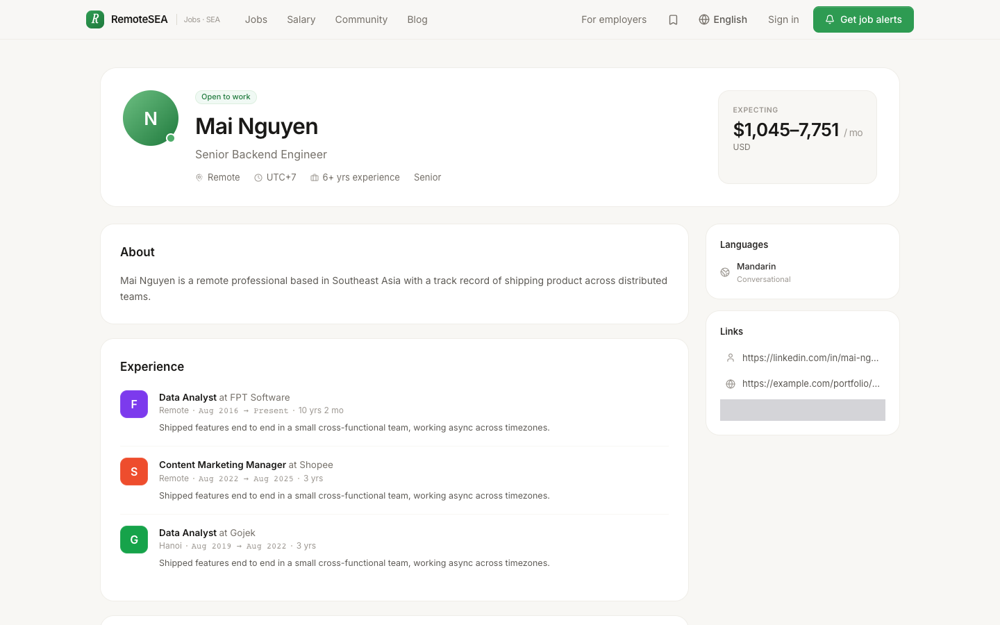

### S2-EMPLOYER-VERIFY — Xác minh công ty qua email tên miền (không có token)

| Thuộc tính         | Giá trị                                                 |
| ------------------ | ------------------------------------------------------- |
| Sprint             | 2                                                       |
| PB                 | PB32 (Xác minh công ty qua tên miền email doanh nghiệp) |
| Actor chụp         | guest                                                   |
| Route              | `/employer/verify` (đã mở: `/employer/verify`)          |
| Điều kiện truy cập | Công khai — liên kết trong email tên miền công ty       |
| Component          | src/features/employer/pages/EmployerVerifyPage.tsx      |
| Trạng thái chụp    | `OK` → UI status `CAPTURED_NOT_INTERACTION_TESTED`      |
| Mức bằng chứng     | Runtime                                                 |
| DOM đo được        | 0 input · 0 form · 0 bảng · 1 link                      |

**Mục đích.** Xác nhận công ty qua email tên miền doanh nghiệp (POST /employer/verification/confirm).

**Hành vi đã quan sát.** Không có token → trạng thái liên kết không hợp lệ.

**Hạn chế / chưa xác minh.** Backlog PB32 mô tả OTP nhập trong 15 phút, implementation dùng liên kết/token (đã ghi trong SPRINT2_TEST_REPORT.md, lỗi S2-D15).

Tiêu đề đo được trên trang (1)

- H1: Link expired or invalid

| Trạng thái UI             | Viewport            | Ảnh                                                                                                                            |
| ------------------------- | ------------------- | ------------------------------------------------------------------------------------------------------------------------------ |
| Viewport desktop 1440×900 | desktop             | [PB32-guest-employer-domain-verify-desktop.png](screenshots/sprint-02/PB32-guest-employer-domain-verify-desktop.png)           |
| Toàn trang desktop        | desktop (full page) | [PB32-guest-employer-domain-verify-desktop-full.png](screenshots/sprint-02/PB32-guest-employer-domain-verify-desktop-full.png) |

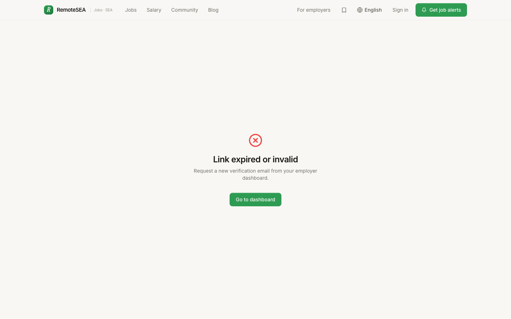

### S2-TEAM-INVITE — Chấp nhận lời mời gia nhập công ty (token không hợp lệ)

| Thuộc tính         | Giá trị                                                                      |
| ------------------ | ---------------------------------------------------------------------------- |
| Sprint             | 2                                                                            |
| PB                 | PB36 (Chấp nhận lời mời gia nhập công ty)                                    |
| Actor chụp         | guest                                                                        |
| Route              | `/team/invitations/:token` (đã mở: `/team/invitations/invalid-sample-token`) |
| Điều kiện truy cập | Công khai — người được mời có thể chưa có tài khoản                          |
| Component          | src/features/team/pages/TeamInvitePage.tsx                                   |
| Trạng thái chụp    | `OK` → UI status `CAPTURED_NOT_INTERACTION_TESTED`                           |
| Mức bằng chứng     | Runtime                                                                      |
| DOM đo được        | 0 input · 0 form · 0 bảng · 0 link                                           |

**Mục đích.** Xem và chấp nhận lời mời gia nhập đội tuyển dụng của công ty.

**Hành vi đã quan sát.** Token không hợp lệ → thông báo lời mời không tồn tại/hết hạn.

**Hạn chế / chưa xác minh.** Không có token mời thật (tạo lời mời sẽ gửi email) → trạng thái chấp nhận thành công chưa chụp.

| Trạng thái UI             | Viewport            | Ảnh                                                                                                                            |
| ------------------------- | ------------------- | ------------------------------------------------------------------------------------------------------------------------------ |
| Viewport desktop 1440×900 | desktop             | [PB36-guest-team-accept-invitation-desktop.png](screenshots/sprint-02/PB36-guest-team-accept-invitation-desktop.png)           |
| Toàn trang desktop        | desktop (full page) | [PB36-guest-team-accept-invitation-desktop-full.png](screenshots/sprint-02/PB36-guest-team-accept-invitation-desktop-full.png) |

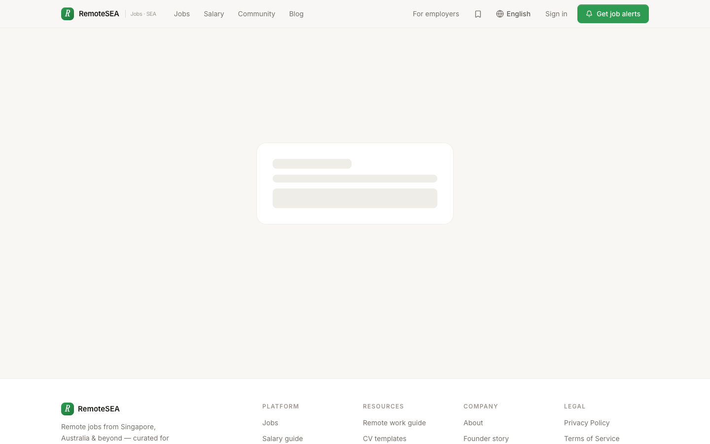

### S2-POSTJOB-SUCCESS — Trang trả về sau Stripe Checkout (không có session)

| Thuộc tính         | Giá trị                                                                                                                                                                           |
| ------------------ | --------------------------------------------------------------------------------------------------------------------------------------------------------------------------------- |
| Sprint             | 2                                                                                                                                                                                 |
| PB                 | PB43 (Thanh toán đăng tin tuyển dụng qua Stripe) PB80 (Khởi tạo thanh toán đăng tin qua cổng Stripe Checkout) PB81 (Xác nhận kết quả thanh toán tự động qua Stripe Webhook) |
| Actor chụp         | guest                                                                                                                                                                             |
| Route              | `/post-job/success` (đã mở: `/post-job/success`)                                                                                                                                  |
| Điều kiện truy cập | Công khai — đích quay về từ Stripe Checkout                                                                                                                                       |
| Component          | src/features/post-job/pages/PostJobSuccessPage.tsx                                                                                                                                |
| Trạng thái chụp    | `OK` → UI status `CAPTURED_NOT_INTERACTION_TESTED`                                                                                                                                |
| Mức bằng chứng     | Runtime                                                                                                                                                                           |
| DOM đo được        | 0 input · 0 form · 0 bảng · 1 link                                                                                                                                                |

**Mục đích.** Thông báo kết quả thanh toán gói đăng tin.

**Hành vi đã quan sát.** Mở trực tiếp không có session_id → trạng thái không có thông tin phiên thanh toán.

**Hạn chế / chưa xác minh.** Không thanh toán thật (Stripe) theo yêu cầu an toàn → trạng thái thanh toán thành công chưa chụp.

Tiêu đề đo được trên trang (1)

- H1: Thanks for your submission

| Trạng thái UI             | Viewport            | Ảnh                                                                                                                              |
| ------------------------- | ------------------- | -------------------------------------------------------------------------------------------------------------------------------- |
| Viewport desktop 1440×900 | desktop             | [PB43-guest-billing-checkout-return-desktop.png](screenshots/sprint-02/PB43-guest-billing-checkout-return-desktop.png)           |
| Toàn trang desktop        | desktop (full page) | [PB43-guest-billing-checkout-return-desktop-full.png](screenshots/sprint-02/PB43-guest-billing-checkout-return-desktop-full.png) |

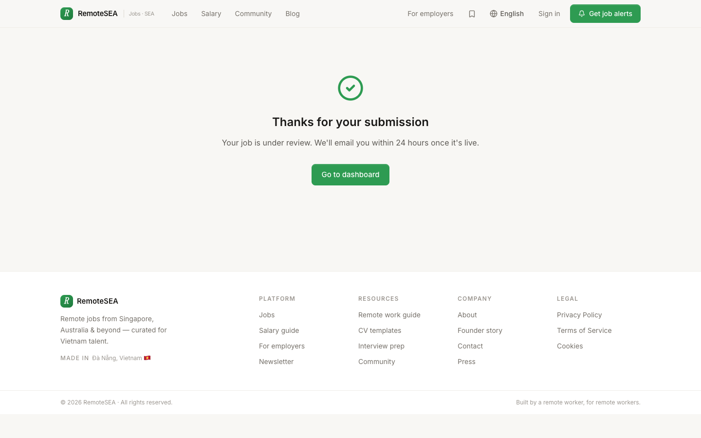

### S2-TALENT-DASH — Bảng điều khiển ứng viên

| Thuộc tính         | Giá trị                                                                                                                                                                                                       |
| ------------------ | ------------------------------------------------------------------------------------------------------------------------------------------------------------------------------------------------------------- |
| Sprint             | 2                                                                                                                                                                                                             |
| PB                 | PB26 (Xem bảng điều khiển ứng viên (Talent Dashboard)) PB27 (Xem thống kê lượt xem hồ sơ của ứng viên) PB22 (Xác minh email ứng viên) PB54 (Xem chi tiết đơn ứng tuyển và dòng thời gian trạng thái) |
| Actor chụp         | talent                                                                                                                                                                                                        |
| Route              | `/talent` (đã mở: `/talent`)                                                                                                                                                                                  |
| Điều kiện truy cập | —                                                                                                                                                                                                             |
| Component          | —                                                                                                                                                                                                             |
| Trạng thái chụp    | `OK` → UI status `PARTIALLY_CAPTURED` (đã thử lại 1 lần)                                                                                                                                                      |
| Mức bằng chứng     | Runtime                                                                                                                                                                                                       |
| Lỗi API khi chụp   | GET /talent/me/dashboard -> 500                                                                                                                                                                               |
| DOM đo được        | 0 input · 0 form · 0 bảng · 0 link                                                                                                                                                                            |

| Trạng thái UI                                   | Viewport            | Ảnh                                                                                                                                      |
| ----------------------------------------------- | ------------------- | ---------------------------------------------------------------------------------------------------------------------------------------- |
| Viewport desktop 1440×900                       | desktop             | [PB26-talent-talent-dashboard-dashboard-desktop.png](screenshots/sprint-02/PB26-talent-talent-dashboard-dashboard-desktop.png)           |
| Toàn trang desktop                              | desktop (full page) | [PB26-talent-talent-dashboard-dashboard-desktop-full.png](screenshots/sprint-02/PB26-talent-talent-dashboard-dashboard-desktop-full.png) |
| Tab Tất cả đơn ứng tuyển                        | desktop             | [PB26-talent-talent-dashboard-dashboard-tab-all.png](screenshots/sprint-02/PB26-talent-talent-dashboard-dashboard-tab-all.png)           |
| Tab Offer                                       | desktop             | [PB26-talent-talent-dashboard-dashboard-tab-offers.png](screenshots/sprint-02/PB26-talent-talent-dashboard-dashboard-tab-offers.png)     |
| Tab Đã đóng                                     | desktop             | [PB26-talent-talent-dashboard-dashboard-tab-closed.png](screenshots/sprint-02/PB26-talent-talent-dashboard-dashboard-tab-closed.png)     |
| Navbar khi đã đăng nhập — mở thông báo (chuông) | desktop             | [PB26-talent-talent-dashboard-dashboard-user-menu.png](screenshots/sprint-02/PB26-talent-talent-dashboard-dashboard-user-menu.png)       |
| Viewport mobile 390×844                         | mobile              | [PB26-talent-talent-dashboard-dashboard-mobile.png](screenshots/sprint-02/PB26-talent-talent-dashboard-dashboard-mobile.png)             |
| Toàn trang mobile                               | mobile (full page)  | [PB26-talent-talent-dashboard-dashboard-mobile-full.png](screenshots/sprint-02/PB26-talent-talent-dashboard-dashboard-mobile-full.png)   |

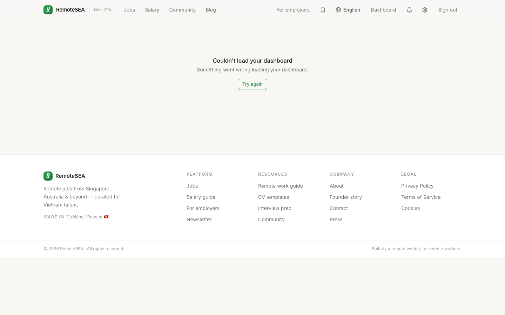

### S2-JOB-DETAIL-TALENT — Chi tiết việc làm (ứng viên đăng nhập: Match Score, Ứng tuyển, Báo cáo)

| Thuộc tính         | Giá trị                                                                                                                                                                                                                                  |
| ------------------ | ---------------------------------------------------------------------------------------------------------------------------------------------------------------------------------------------------------------------------------------- |
| Sprint             | 2                                                                                                                                                                                                                                        |
| PB                 | PB48 (Xem chi tiết tin tuyển dụng) PB50 (Xem điểm phù hợp giữa hồ sơ và công việc (Match Score)) PB53 (Ứng tuyển vào tin tuyển dụng) PB49 (Lưu hoặc bỏ lưu tin tuyển dụng) PB88 (Báo cáo tin tuyển dụng có dấu hiệu vi phạm) |
| Actor chụp         | talent                                                                                                                                                                                                                                   |
| Route              | `/jobs/:id` (đã mở: `/jobs/cmrxb4hds007ae9ze64e91iez`)                                                                                                                                                                                   |
| Điều kiện truy cập | —                                                                                                                                                                                                                                        |
| Component          | —                                                                                                                                                                                                                                        |
| Trạng thái chụp    | `OK` → UI status `CAPTURED_AND_VERIFIED`                                                                                                                                                                                                 |
| Mức bằng chứng     | Runtime                                                                                                                                                                                                                                  |
| DOM đo được        | 0 input · 0 form · 0 bảng · 3 link                                                                                                                                                                                                       |

Tiêu đề đo được trên trang (5)

- H1: Product Designer
- H2: About the role
- H2: Skills & technologies
- H2: Benefits
- H3: Company

| Trạng thái UI                        | Viewport            | Ảnh                                                                                                                              |
| ------------------------------------ | ------------------- | -------------------------------------------------------------------------------------------------------------------------------- |
| Viewport desktop 1440×900            | desktop             | [PB48-talent-jobs-job-detail-talent-desktop.png](screenshots/sprint-02/PB48-talent-jobs-job-detail-talent-desktop.png)           |
| Toàn trang desktop                   | desktop (full page) | [PB48-talent-jobs-job-detail-talent-desktop-full.png](screenshots/sprint-02/PB48-talent-jobs-job-detail-talent-desktop-full.png) |
| Mở form ứng tuyển inline (không gửi) | desktop             | [PB48-talent-jobs-job-detail-talent-apply-form.png](screenshots/sprint-02/PB48-talent-jobs-job-detail-talent-apply-form.png)     |
| Mở form báo cáo vi phạm (không gửi)  | desktop             | [PB48-talent-jobs-job-detail-talent-report-form.png](screenshots/sprint-02/PB48-talent-jobs-job-detail-talent-report-form.png)   |

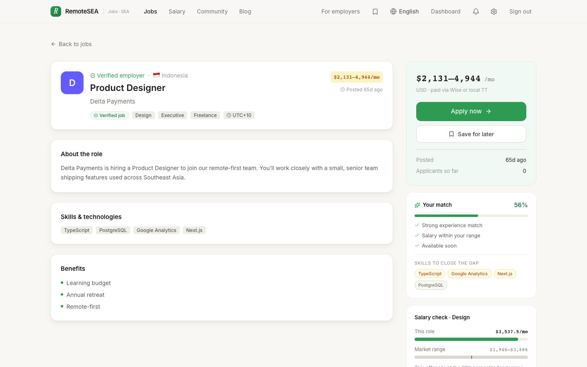

### S2-EMP-DASH — Bảng điều khiển nhà tuyển dụng

| Thuộc tính         | Giá trị                                                                                                                                                                                                                                                                                                                             |
| ------------------ | ----------------------------------------------------------------------------------------------------------------------------------------------------------------------------------------------------------------------------------------------------------------------------------------------------------------------------------- |
| Sprint             | 2                                                                                                                                                                                                                                                                                                                                   |
| PB                 | PB34 (Xem bảng điều khiển nhà tuyển dụng (Employer Dashboard)) PB57 (Xem danh sách ứng viên của tin tuyển dụng (Applicants Panel)) PB59 (Cập nhật hàng loạt trạng thái đơn ứng tuyển (Bulk Action)) PB45 (Đóng tin tuyển dụng) PB31 (Cập nhật hồ sơ công ty) PB32 (Xác minh công ty qua tên miền email doanh nghiệp) |
| Actor chụp         | employer                                                                                                                                                                                                                                                                                                                            |
| Route              | `/employer-dashboard` (đã mở: `/employer-dashboard`)                                                                                                                                                                                                                                                                                |
| Điều kiện truy cập | —                                                                                                                                                                                                                                                                                                                                   |
| Component          | —                                                                                                                                                                                                                                                                                                                                   |
| Trạng thái chụp    | `PARTIAL` → UI status `PARTIALLY_CAPTURED` (đã thử lại 1 lần)                                                                                                                                                                                                                                                                       |
| Mức bằng chứng     | Runtime                                                                                                                                                                                                                                                                                                                             |
| Lỗi API khi chụp   | GET /employer/dashboard -> 500                                                                                                                                                                                                                                                                                                      |
| DOM đo được        | 0 input · 0 form · 0 bảng · 0 link                                                                                                                                                                                                                                                                                                  |

| Trạng thái UI             | Viewport            | Ảnh                                                                                                                                                    |
| ------------------------- | ------------------- | ------------------------------------------------------------------------------------------------------------------------------------------------------ |
| Viewport desktop 1440×900 | desktop             | [PB34-employer-employer-dashboard-dashboard-desktop.png](screenshots/sprint-02/PB34-employer-employer-dashboard-dashboard-desktop.png)                 |
| Toàn trang desktop        | desktop (full page) | [PB34-employer-employer-dashboard-dashboard-desktop-full.png](screenshots/sprint-02/PB34-employer-employer-dashboard-dashboard-desktop-full.png)       |
| Tab ứng viên Mới          | desktop             | [PB34-employer-employer-dashboard-dashboard-tab-new.png](screenshots/sprint-02/PB34-employer-employer-dashboard-dashboard-tab-new.png)                 |
| Tab ứng viên Shortlist    | desktop             | [PB34-employer-employer-dashboard-dashboard-tab-shortlisted.png](screenshots/sprint-02/PB34-employer-employer-dashboard-dashboard-tab-shortlisted.png) |
| Viewport mobile 390×844   | mobile              | [PB34-employer-employer-dashboard-dashboard-mobile.png](screenshots/sprint-02/PB34-employer-employer-dashboard-dashboard-mobile.png)                   |
| Toàn trang mobile         | mobile (full page)  | [PB34-employer-employer-dashboard-dashboard-mobile-full.png](screenshots/sprint-02/PB34-employer-employer-dashboard-dashboard-mobile-full.png)         |

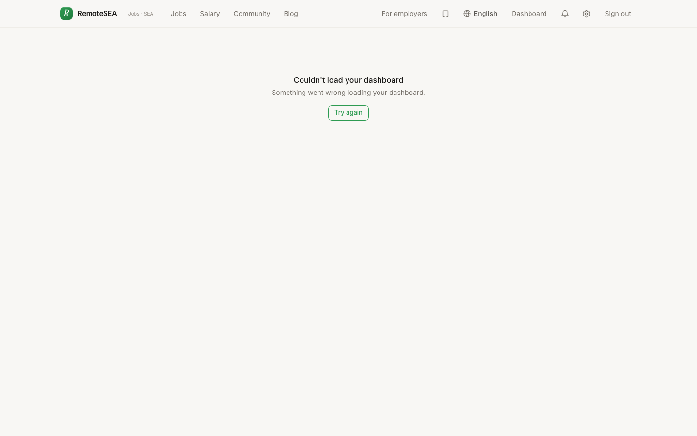

**Không chụp được:** bulk-select (TimeoutError: locator.scrollIntoViewIfNeeded: Timeout 30000ms exceeded.)

### S2-POSTJOB — Đăng tin tuyển dụng (wizard 4 bước)

| Thuộc tính         | Giá trị                                                                                                                                                                                          |
| ------------------ | ------------------------------------------------------------------------------------------------------------------------------------------------------------------------------------------------ |
| Sprint             | 2                                                                                                                                                                                                |
| PB                 | PB41 (Tạo tin tuyển dụng ở trạng thái nháp (Draft Job)) PB30 (Tạo hồ sơ công ty (Onboarding Employer)) PB42 (Chỉnh sửa tin tuyển dụng) PB43 (Thanh toán đăng tin tuyển dụng qua Stripe) |
| Actor chụp         | employer                                                                                                                                                                                         |
| Route              | `/post-job` (đã mở: `/post-job`)                                                                                                                                                                 |
| Điều kiện truy cập | —                                                                                                                                                                                                |
| Component          | —                                                                                                                                                                                                |
| Trạng thái chụp    | `OK` → UI status `CAPTURED_AND_VERIFIED`                                                                                                                                                         |
| Mức bằng chứng     | Runtime                                                                                                                                                                                          |
| DOM đo được        | 9 input · 0 form · 0 bảng · 0 link                                                                                                                                                               |

Tiêu đề đo được trên trang (3)

- H1: Post a job
- H2: About your company
- H3: Recruiter / hiring manager

| Trạng thái UI                                | Viewport            | Ảnh                                                                                                                            |
| -------------------------------------------- | ------------------- | ------------------------------------------------------------------------------------------------------------------------------ |
| Viewport desktop 1440×900                    | desktop             | [PB41-employer-post-job-wizard-desktop.png](screenshots/sprint-02/PB41-employer-post-job-wizard-desktop.png)                   |
| Toàn trang desktop                           | desktop (full page) | [PB41-employer-post-job-wizard-desktop-full.png](screenshots/sprint-02/PB41-employer-post-job-wizard-desktop-full.png)         |
| Bước 2 — Vai trò                             | desktop             | [PB41-employer-post-job-wizard-step2-role.png](screenshots/sprint-02/PB41-employer-post-job-wizard-step2-role.png)             |
| Bước 2 bấm Tiếp tục khi chưa nhập → lỗi bước | desktop             | [PB41-employer-post-job-wizard-step2-validation.png](screenshots/sprint-02/PB41-employer-post-job-wizard-step2-validation.png) |
| Viewport mobile 390×844                      | mobile              | [PB41-employer-post-job-wizard-mobile.png](screenshots/sprint-02/PB41-employer-post-job-wizard-mobile.png)                     |
| Toàn trang mobile                            | mobile (full page)  | [PB41-employer-post-job-wizard-mobile-full.png](screenshots/sprint-02/PB41-employer-post-job-wizard-mobile-full.png)           |

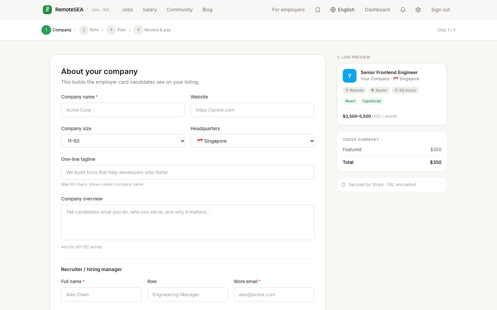

### S2-TALENT-SEARCH — Tìm kiếm ứng viên

| Thuộc tính         | Giá trị                                                                                          |
| ------------------ | ------------------------------------------------------------------------------------------------ |
| Sprint             | 2                                                                                                |
| PB                 | PB29 (Tìm kiếm ứng viên (Talent Search)) PB79 (Mời ứng viên tiềm năng ứng tuyển vào việc làm) |
| Actor chụp         | employer                                                                                         |
| Route              | `/employer-dashboard/talent` (đã mở: `/employer-dashboard/talent`)                               |
| Điều kiện truy cập | —                                                                                                |
| Component          | —                                                                                                |
| Trạng thái chụp    | `OK` → UI status `PARTIALLY_CAPTURED`                                                            |
| Mức bằng chứng     | Runtime                                                                                          |
| Lỗi API khi chụp   | GET /employer/jobs -> 500, GET /talent -> 500                                                    |
| DOM đo được        | 31 input · 0 form · 0 bảng · 12 link                                                             |

Tiêu đề đo được trên trang (7)

- H1: Find talent
- H3: Filters
- H3: Executive UX Researcher
- H3: Senior Backend Engineer
- H3: Backend Engineer
- H3: Senior Full-Stack Engineer
- H3: Senior Data Engineer

| Trạng thái UI               | Viewport            | Ảnh                                                                                                                                            |
| --------------------------- | ------------------- | ---------------------------------------------------------------------------------------------------------------------------------------------- |
| Viewport desktop 1440×900   | desktop             | [PB29-employer-talent-search-talent-search-desktop.png](screenshots/sprint-02/PB29-employer-talent-search-talent-search-desktop.png)           |
| Toàn trang desktop          | desktop (full page) | [PB29-employer-talent-search-talent-search-desktop-full.png](screenshots/sprint-02/PB29-employer-talent-search-talent-search-desktop-full.png) |
| Lọc cấp độ Senior           | desktop             | [PB29-employer-talent-search-talent-search-filtered.png](screenshots/sprint-02/PB29-employer-talent-search-talent-search-filtered.png)         |
| Tìm theo từ khoá 'engineer' | desktop             | [PB29-employer-talent-search-talent-search-search.png](screenshots/sprint-02/PB29-employer-talent-search-talent-search-search.png)             |
| Viewport mobile 390×844     | mobile              | [PB29-employer-talent-search-talent-search-mobile.png](screenshots/sprint-02/PB29-employer-talent-search-talent-search-mobile.png)             |
| Toàn trang mobile           | mobile (full page)  | [PB29-employer-talent-search-talent-search-mobile-full.png](screenshots/sprint-02/PB29-employer-talent-search-talent-search-mobile-full.png)   |

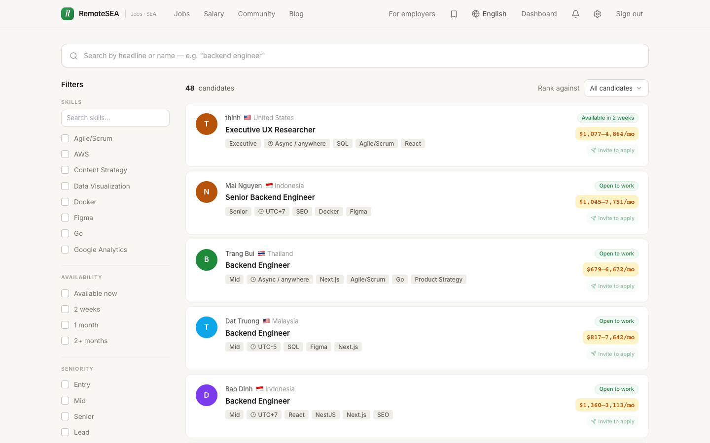

### S2-TEAM — Quản lý thành viên công ty

| Thuộc tính         | Giá trị                                                                                                                                                                                                                                               |
| ------------------ | ----------------------------------------------------------------------------------------------------------------------------------------------------------------------------------------------------------------------------------------------------- |
| Sprint             | 2                                                                                                                                                                                                                                                     |
| PB                 | PB37 (Xem danh sách thành viên trong công ty) PB35 (Mời thành viên vào đội ngũ tuyển dụng công ty) PB38 (Thu hồi lời mời tham gia đang chờ) PB39 (Đổi vai trò thành viên hoặc chuyển giao quyền OWNER) PB40 (Xóa thành viên khỏi công ty) |
| Actor chụp         | employer                                                                                                                                                                                                                                              |
| Route              | `/employer-dashboard/team` (đã mở: `/employer-dashboard/team`)                                                                                                                                                                                        |
| Điều kiện truy cập | —                                                                                                                                                                                                                                                     |
| Component          | —                                                                                                                                                                                                                                                     |
| Trạng thái chụp    | `OK` → UI status `CAPTURED_AND_VERIFIED`                                                                                                                                                                                                              |
| Mức bằng chứng     | Runtime                                                                                                                                                                                                                                               |
| DOM đo được        | 10 input · 1 form · 0 bảng · 1 link                                                                                                                                                                                                                   |

Tiêu đề đo được trên trang (12)

- H1: Team members.
- H2: Team members
- H2: Remove Thu Le?
- H2: Transfer ownership to Thu Le?
- H2: Remove Duc Pham?
- H2: Transfer ownership to Duc Pham?
- H2: Remove Linh Vu?
- H2: Transfer ownership to Linh Vu?
- H2: Remove Khanh Hoang?
- H2: Transfer ownership to Khanh Hoang?
- H2: Invite a team member
- H2: Revoke invitation?

| Trạng thái UI                                 | Viewport            | Ảnh                                                                                                                                    |
| --------------------------------------------- | ------------------- | -------------------------------------------------------------------------------------------------------------------------------------- |
| Viewport desktop 1440×900                     | desktop             | [PB37-employer-team-team-settings-desktop.png](screenshots/sprint-02/PB37-employer-team-team-settings-desktop.png)                     |
| Toàn trang desktop                            | desktop (full page) | [PB37-employer-team-team-settings-desktop-full.png](screenshots/sprint-02/PB37-employer-team-team-settings-desktop-full.png)           |
| Form mời thành viên gửi rỗng → lỗi validation | desktop             | [PB37-employer-team-team-settings-invite-validation.png](screenshots/sprint-02/PB37-employer-team-team-settings-invite-validation.png) |

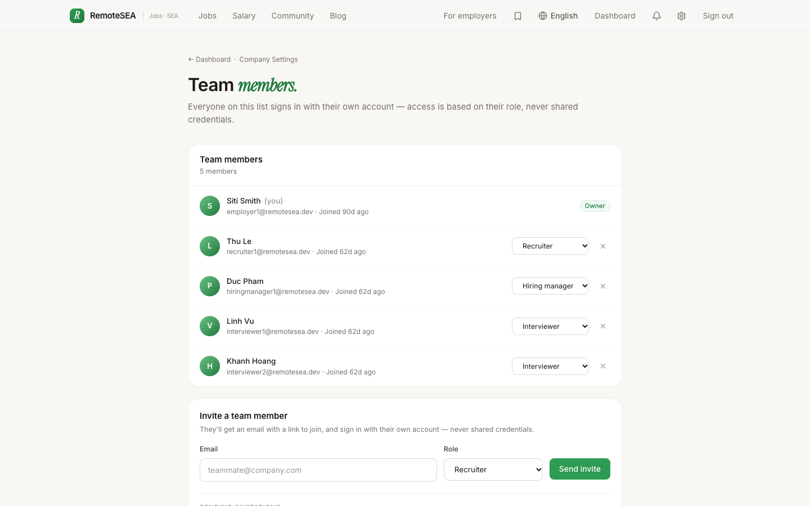

### S2-COMPANY-OWNER — Trang công ty của chính nhà tuyển dụng

| Thuộc tính         | Giá trị                                                                   |
| ------------------ | ------------------------------------------------------------------------- |
| Sprint             | 2                                                                         |
| PB                 | PB31 (Cập nhật hồ sơ công ty) PB33 (Xem trang hồ sơ công ty công khai) |
| Actor chụp         | employer                                                                  |
| Route              | `/companies/:slug` (đã mở: `/companies/mekong-digital-bhSuHu`)            |
| Điều kiện truy cập | —                                                                         |
| Component          | —                                                                         |
| Trạng thái chụp    | `OK` → UI status `CAPTURED_NOT_INTERACTION_TESTED`                        |
| Mức bằng chứng     | Runtime                                                                   |
| Lỗi API khi chụp   | GET /saved/ids -> 403, GET /talent/me -> 404                              |
| DOM đo được        | 0 input · 0 form · 0 bảng · 6 link                                        |

Tiêu đề đo được trên trang (4)

- H1: Mekong Digital
- H2: Open positions (2)
- H3: Business Intelligence Analyst
- H3: Design Systems Lead

| Trạng thái UI             | Viewport            | Ảnh                                                                                                                            |
| ------------------------- | ------------------- | ------------------------------------------------------------------------------------------------------------------------------ |
| Viewport desktop 1440×900 | desktop             | [PB31-employer-company-own-company-desktop.png](screenshots/sprint-02/PB31-employer-company-own-company-desktop.png)           |
| Toàn trang desktop        | desktop (full page) | [PB31-employer-company-own-company-desktop-full.png](screenshots/sprint-02/PB31-employer-company-own-company-desktop-full.png) |

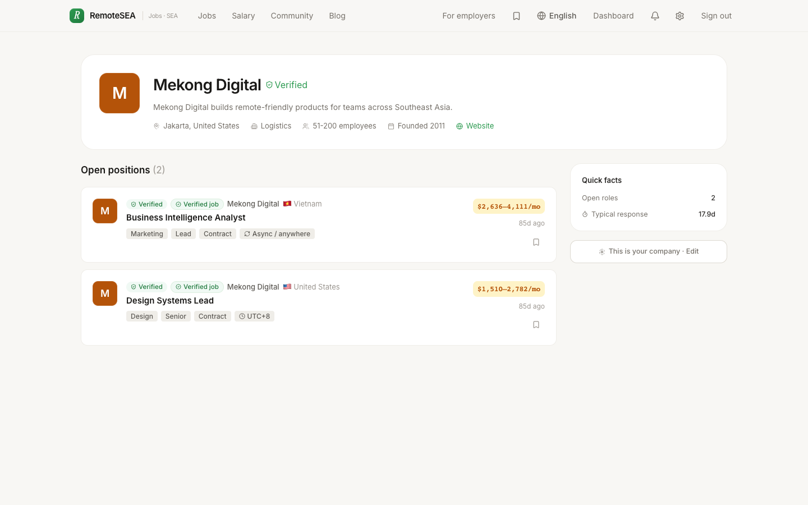

## Sprint 3 — Ứng tuyển, Phỏng vấn, Đánh giá, Tin nhắn & Thanh toán

### S3-SAVED — Việc làm đã lưu

| Thuộc tính         | Giá trị                               |
| ------------------ | ------------------------------------- |
| Sprint             | 3                                     |
| PB                 | PB49 (Lưu hoặc bỏ lưu tin tuyển dụng) |
| Actor chụp         | talent                                |
| Route              | `/saved` (đã mở: `/saved`)            |
| Điều kiện truy cập | —                                     |
| Component          | —                                     |
| Trạng thái chụp    | `OK` → UI status `PARTIALLY_CAPTURED` |
| Mức bằng chứng     | Runtime                               |
| Lỗi API khi chụp   | GET /saved -> 500                     |
| DOM đo được        | 0 input · 0 form · 0 bảng · 1 link    |

Tiêu đề đo được trên trang (1)

- H1: Saved jobs

| Trạng thái UI             | Viewport            | Ảnh                                                                                                                            |
| ------------------------- | ------------------- | ------------------------------------------------------------------------------------------------------------------------------ |
| Viewport desktop 1440×900 | desktop             | [PB49-talent-saved-jobs-saved-jobs-desktop.png](screenshots/sprint-03/PB49-talent-saved-jobs-saved-jobs-desktop.png)           |
| Toàn trang desktop        | desktop (full page) | [PB49-talent-saved-jobs-saved-jobs-desktop-full.png](screenshots/sprint-03/PB49-talent-saved-jobs-saved-jobs-desktop-full.png) |

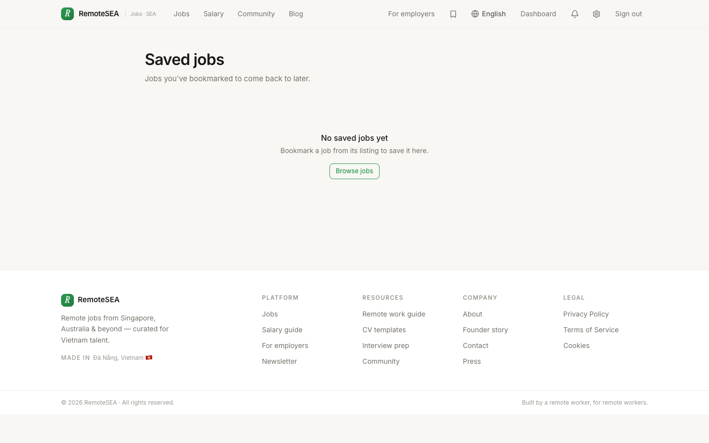

### S3-APP-DETAIL-OFFER — Chi tiết đơn ứng tuyển — trạng thái Offer

| Thuộc tính         | Giá trị                                                                                                                                                                                                                                                                 |
| ------------------ | ----------------------------------------------------------------------------------------------------------------------------------------------------------------------------------------------------------------------------------------------------------------------- |
| Sprint             | 3                                                                                                                                                                                                                                                                       |
| PB                 | PB54 (Xem chi tiết đơn ứng tuyển và dòng thời gian trạng thái) PB56 (Phản hồi lời mời làm việc (Chấp nhận hoặc Từ chối Offer)) PB55 (Rút đơn ứng tuyển) PB70 (Kiểm tra điều kiện được phép đánh giá hai chiều) PB71 (Viết đánh giá hai chiều sau phỏng vấn) |
| Actor chụp         | talent                                                                                                                                                                                                                                                                  |
| Route              | `/applications/:id` (đã mở: `/applications/cmrxb5enu00b6e9ze2jw0k085`)                                                                                                                                                                                                  |
| Điều kiện truy cập | —                                                                                                                                                                                                                                                                       |
| Component          | —                                                                                                                                                                                                                                                                       |
| Trạng thái chụp    | `OK` → UI status `CAPTURED_NOT_INTERACTION_TESTED`                                                                                                                                                                                                                      |
| Mức bằng chứng     | Runtime                                                                                                                                                                                                                                                                 |
| DOM đo được        | 0 input · 0 form · 0 bảng · 2 link                                                                                                                                                                                                                                      |

Tiêu đề đo được trên trang (1)

- H1: Bamboo Labs

| Trạng thái UI             | Viewport            | Ảnh                                                                                                                                              |
| ------------------------- | ------------------- | ------------------------------------------------------------------------------------------------------------------------------------------------ |
| Viewport desktop 1440×900 | desktop             | [PB54-talent-applications-application-offer-desktop.png](screenshots/sprint-03/PB54-talent-applications-application-offer-desktop.png)           |
| Toàn trang desktop        | desktop (full page) | [PB54-talent-applications-application-offer-desktop-full.png](screenshots/sprint-03/PB54-talent-applications-application-offer-desktop-full.png) |
| Viewport mobile 390×844   | mobile              | [PB54-talent-applications-application-offer-mobile.png](screenshots/sprint-03/PB54-talent-applications-application-offer-mobile.png)             |
| Toàn trang mobile         | mobile (full page)  | [PB54-talent-applications-application-offer-mobile-full.png](screenshots/sprint-03/PB54-talent-applications-application-offer-mobile-full.png)   |

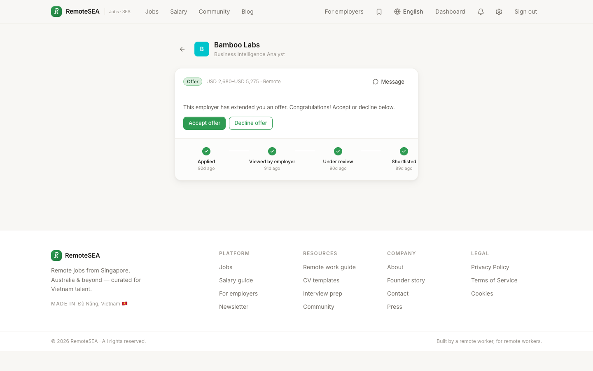

### S3-APP-DETAIL-INTERVIEW — Chi tiết đơn ứng tuyển — trạng thái Phỏng vấn

| Thuộc tính         | Giá trị                                                                                                   |
| ------------------ | --------------------------------------------------------------------------------------------------------- |
| Sprint             | 3                                                                                                         |
| PB                 | PB54 (Xem chi tiết đơn ứng tuyển và dòng thời gian trạng thái) PB61 (Ứng viên xác nhận lịch phỏng vấn) |
| Actor chụp         | talent                                                                                                    |
| Route              | `/applications/:id` (đã mở: `/applications/cmt2lgko7000cbmeondz7lhv8`)                                    |
| Điều kiện truy cập | —                                                                                                         |
| Component          | —                                                                                                         |
| Trạng thái chụp    | `OK` → UI status `CAPTURED_NOT_INTERACTION_TESTED`                                                        |
| Mức bằng chứng     | Runtime                                                                                                   |
| DOM đo được        | 0 input · 0 form · 0 bảng · 3 link                                                                        |

Tiêu đề đo được trên trang (1)

- H1: Mekong Digital

| Trạng thái UI             | Viewport            | Ảnh                                                                                                                                                      |
| ------------------------- | ------------------- | -------------------------------------------------------------------------------------------------------------------------------------------------------- |
| Viewport desktop 1440×900 | desktop             | [PB54-talent-applications-application-interview-desktop.png](screenshots/sprint-03/PB54-talent-applications-application-interview-desktop.png)           |
| Toàn trang desktop        | desktop (full page) | [PB54-talent-applications-application-interview-desktop-full.png](screenshots/sprint-03/PB54-talent-applications-application-interview-desktop-full.png) |

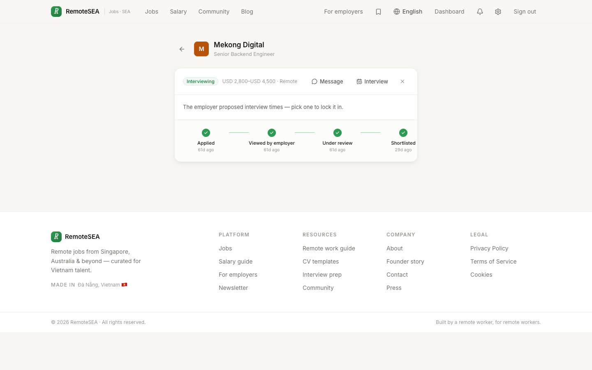

### S3-APP-DETAIL-PENDING — Chi tiết đơn ứng tuyển — trạng thái Chờ xử lý

| Thuộc tính         | Giá trị                                                                                    |
| ------------------ | ------------------------------------------------------------------------------------------ |
| Sprint             | 3                                                                                          |
| PB                 | PB54 (Xem chi tiết đơn ứng tuyển và dòng thời gian trạng thái) PB55 (Rút đơn ứng tuyển) |
| Actor chụp         | talent                                                                                     |
| Route              | `/applications/:id` (đã mở: `/applications/cmt8ffpal0002hkb8fwbgj8t4`)                     |
| Điều kiện truy cập | —                                                                                          |
| Component          | —                                                                                          |
| Trạng thái chụp    | `OK` → UI status `CAPTURED_NOT_INTERACTION_TESTED`                                         |
| Mức bằng chứng     | Runtime                                                                                    |
| DOM đo được        | 0 input · 0 form · 0 bảng · 2 link                                                         |

Tiêu đề đo được trên trang (1)

- H1: Saigon Cloudworks

| Trạng thái UI             | Viewport            | Ảnh                                                                                                                                                  |
| ------------------------- | ------------------- | ---------------------------------------------------------------------------------------------------------------------------------------------------- |
| Viewport desktop 1440×900 | desktop             | [PB54-talent-applications-application-pending-desktop.png](screenshots/sprint-03/PB54-talent-applications-application-pending-desktop.png)           |
| Toàn trang desktop        | desktop (full page) | [PB54-talent-applications-application-pending-desktop-full.png](screenshots/sprint-03/PB54-talent-applications-application-pending-desktop-full.png) |

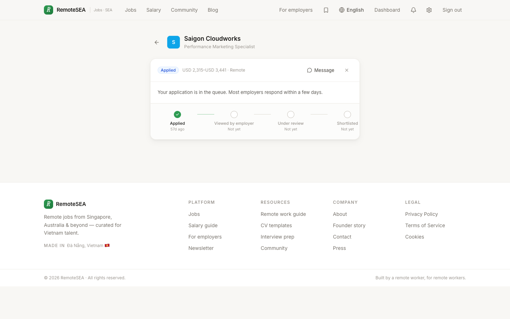

### S3-MESSAGES-TALENT — Nhắn tin theo đơn ứng tuyển (ứng viên)

| Thuộc tính         | Giá trị                                                                                  |
| ------------------ | ---------------------------------------------------------------------------------------- |
| Sprint             | 3                                                                                        |
| PB                 | PB68 (Nhắn tin trao đổi theo ngữ cảnh đơn ứng tuyển)                                     |
| Actor chụp         | talent                                                                                   |
| Route              | `/applications/:id/messages` (đã mở: `/applications/cmt2lgko7000cbmeondz7lhv8/messages`) |
| Điều kiện truy cập | —                                                                                        |
| Component          | —                                                                                        |
| Trạng thái chụp    | `OK` → UI status `CAPTURED_NOT_INTERACTION_TESTED`                                       |
| Mức bằng chứng     | Runtime                                                                                  |
| DOM đo được        | 1 input · 1 form · 0 bảng · 1 link                                                       |

Tiêu đề đo được trên trang (1)

- H1: Mekong Digital

| Trạng thái UI             | Viewport            | Ảnh                                                                                                                |
| ------------------------- | ------------------- | ------------------------------------------------------------------------------------------------------------------ |
| Viewport desktop 1440×900 | desktop             | [PB68-talent-messages-thread-desktop.png](screenshots/sprint-03/PB68-talent-messages-thread-desktop.png)           |
| Toàn trang desktop        | desktop (full page) | [PB68-talent-messages-thread-desktop-full.png](screenshots/sprint-03/PB68-talent-messages-thread-desktop-full.png) |
| Viewport mobile 390×844   | mobile              | [PB68-talent-messages-thread-mobile.png](screenshots/sprint-03/PB68-talent-messages-thread-mobile.png)             |
| Toàn trang mobile         | mobile (full page)  | [PB68-talent-messages-thread-mobile-full.png](screenshots/sprint-03/PB68-talent-messages-thread-mobile-full.png)   |

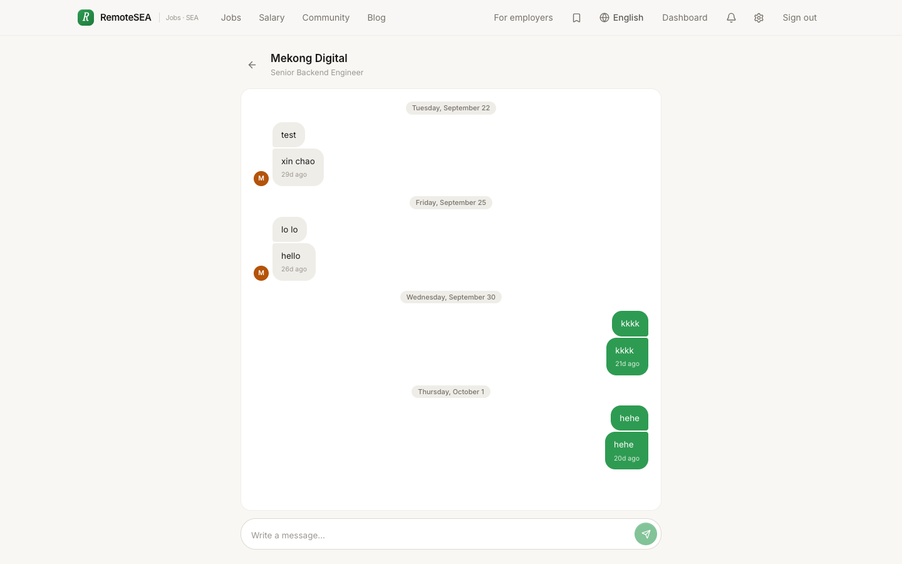

### S3-INTERVIEW-TALENT — Lịch phỏng vấn (ứng viên xác nhận / tải .ics)

| Thuộc tính         | Giá trị                                                                                    |
| ------------------ | ------------------------------------------------------------------------------------------ |
| Sprint             | 3                                                                                          |
| PB                 | PB61 (Ứng viên xác nhận lịch phỏng vấn) PB63 (Tải tệp lịch phỏng vấn (.ics))            |
| Actor chụp         | talent                                                                                     |
| Route              | `/applications/:id/interview` (đã mở: `/applications/cmt2lgko7000cbmeondz7lhv8/interview`) |
| Điều kiện truy cập | —                                                                                          |
| Component          | —                                                                                          |
| Trạng thái chụp    | `OK` → UI status `CAPTURED_NOT_INTERACTION_TESTED`                                         |
| Mức bằng chứng     | Runtime                                                                                    |
| DOM đo được        | 0 input · 0 form · 0 bảng · 2 link                                                         |

Tiêu đề đo được trên trang (1)

- H1: Mekong Digital

| Trạng thái UI             | Viewport            | Ảnh                                                                                                                                        |
| ------------------------- | ------------------- | ------------------------------------------------------------------------------------------------------------------------------------------ |
| Viewport desktop 1440×900 | desktop             | [PB61-talent-interviews-interview-talent-desktop.png](screenshots/sprint-03/PB61-talent-interviews-interview-talent-desktop.png)           |
| Toàn trang desktop        | desktop (full page) | [PB61-talent-interviews-interview-talent-desktop-full.png](screenshots/sprint-03/PB61-talent-interviews-interview-talent-desktop-full.png) |

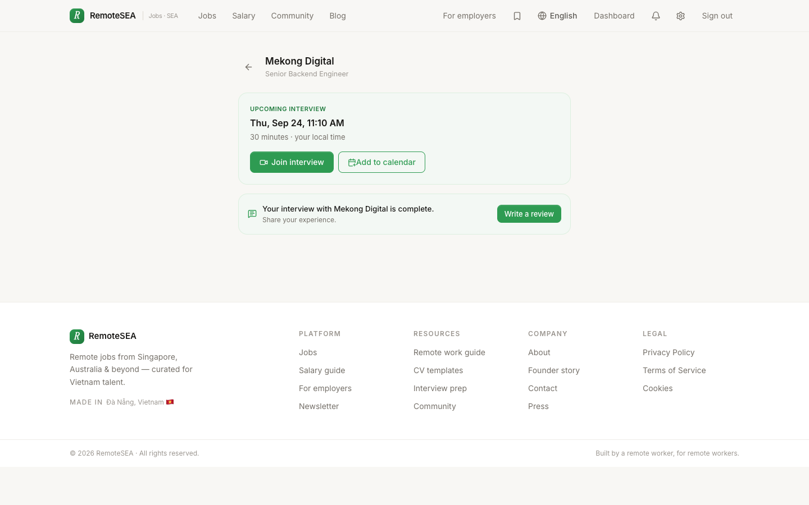

### S3-NOTIFICATIONS — Trung tâm thông báo

| Thuộc tính         | Giá trị                                                                                                                                   |
| ------------------ | ----------------------------------------------------------------------------------------------------------------------------------------- |
| Sprint             | 3                                                                                                                                         |
| PB                 | PB73 (Nhận thông báo trong ứng dụng (In-app Notifications)) PB74 (Xem số lượng thông báo chưa đọc) PB75 (Đánh dấu thông báo đã đọc) |
| Actor chụp         | talent                                                                                                                                    |
| Route              | `/notifications` (đã mở: `/notifications`)                                                                                                |
| Điều kiện truy cập | —                                                                                                                                         |
| Component          | —                                                                                                                                         |
| Trạng thái chụp    | `OK` → UI status `PARTIALLY_CAPTURED`                                                                                                     |
| Mức bằng chứng     | Runtime                                                                                                                                   |
| Lỗi API khi chụp   | GET /notifications -> 500                                                                                                                 |
| DOM đo được        | 0 input · 0 form · 0 bảng · 0 link                                                                                                        |

Tiêu đề đo được trên trang (7)

- H1: Notifications
- H2: Friday, September 25
- H2: Wednesday, September 23
- H2: Tuesday, September 22
- H2: Friday, August 21
- H2: Tuesday, August 18
- H2: Monday, August 17

| Trạng thái UI                           | Viewport            | Ảnh                                                                                                                                          |
| --------------------------------------- | ------------------- | -------------------------------------------------------------------------------------------------------------------------------------------- |
| Viewport desktop 1440×900               | desktop             | [PB73-talent-notifications-notifications-desktop.png](screenshots/sprint-03/PB73-talent-notifications-notifications-desktop.png)             |
| Toàn trang desktop                      | desktop (full page) | [PB73-talent-notifications-notifications-desktop-full.png](screenshots/sprint-03/PB73-talent-notifications-notifications-desktop-full.png)   |
| Dropdown chuông thông báo + số chưa đọc | desktop             | [PB73-talent-notifications-notifications-bell-dropdown.png](screenshots/sprint-03/PB73-talent-notifications-notifications-bell-dropdown.png) |
| Viewport mobile 390×844                 | mobile              | [PB73-talent-notifications-notifications-mobile.png](screenshots/sprint-03/PB73-talent-notifications-notifications-mobile.png)               |
| Toàn trang mobile                       | mobile (full page)  | [PB73-talent-notifications-notifications-mobile-full.png](screenshots/sprint-03/PB73-talent-notifications-notifications-mobile-full.png)     |

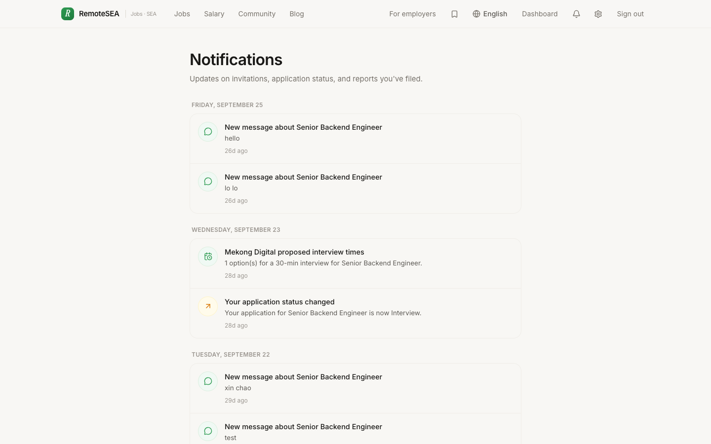

### S3-WORKSPACE — Không gian xử lý hồ sơ ứng viên (pipeline, scorecard, AI CV, ghi chú)

| Thuộc tính         | Giá trị                                                                                                                                                                                                                                                                                                                                                                                                                                            |
| ------------------ | -------------------------------------------------------------------------------------------------------------------------------------------------------------------------------------------------------------------------------------------------------------------------------------------------------------------------------------------------------------------------------------------------------------------------------------------------- |
| Sprint             | 3                                                                                                                                                                                                                                                                                                                                                                                                                                                  |
| PB                 | PB58 (Cập nhật trạng thái đơn ứng tuyển theo pipeline) PB57 (Xem danh sách ứng viên của tin tuyển dụng (Applicants Panel)) PB60 (Đề xuất lịch phỏng vấn cho ứng viên) PB64 (Chấm điểm và đánh giá ứng viên sau phỏng vấn (Scorecard)) PB65 (Xem tổng hợp phiếu đánh giá ứng viên) PB66 (Phân tích hồ sơ CV ứng viên bằng AI) PB67 (Chạy lại phân tích CV bằng AI (Regenerate)) PB69 (Thảo luận và ghi chú nội bộ về ứng viên) |
| Actor chụp         | employer                                                                                                                                                                                                                                                                                                                                                                                                                                           |
| Route              | `/employer-dashboard/applications/:id` (đã mở: `/employer-dashboard/applications/cmt2lgko7000cbmeondz7lhv8`)                                                                                                                                                                                                                                                                                                                                       |
| Điều kiện truy cập | —                                                                                                                                                                                                                                                                                                                                                                                                                                                  |
| Component          | —                                                                                                                                                                                                                                                                                                                                                                                                                                                  |
| Trạng thái chụp    | `PARTIAL` → UI status `PARTIALLY_CAPTURED` (đã thử lại 1 lần)                                                                                                                                                                                                                                                                                                                                                                                      |
| Mức bằng chứng     | Runtime                                                                                                                                                                                                                                                                                                                                                                                                                                            |
| Lỗi API khi chụp   | GET /employer/jobs -> 500                                                                                                                                                                                                                                                                                                                                                                                                                          |
| DOM đo được        | 2 input · 0 form · 0 bảng · 5 link                                                                                                                                                                                                                                                                                                                                                                                                                 |

Tiêu đề đo được trên trang (5)

- H1: thinh
- H3: Team feedback
- H3: Private notes
- H3: Internal discussion
- H3: Activity

| Trạng thái UI             | Viewport            | Ảnh                                                                                                                                              |
| ------------------------- | ------------------- | ------------------------------------------------------------------------------------------------------------------------------------------------ |
| Viewport desktop 1440×900 | desktop             | [PB58-employer-hiring-application-workspace-desktop.png](screenshots/sprint-03/PB58-employer-hiring-application-workspace-desktop.png)           |
| Toàn trang desktop        | desktop (full page) | [PB58-employer-hiring-application-workspace-desktop-full.png](screenshots/sprint-03/PB58-employer-hiring-application-workspace-desktop-full.png) |
| Viewport mobile 390×844   | mobile              | [PB58-employer-hiring-application-workspace-mobile.png](screenshots/sprint-03/PB58-employer-hiring-application-workspace-mobile.png)             |
| Toàn trang mobile         | mobile (full page)  | [PB58-employer-hiring-application-workspace-mobile-full.png](screenshots/sprint-03/PB58-employer-hiring-application-workspace-mobile-full.png)   |

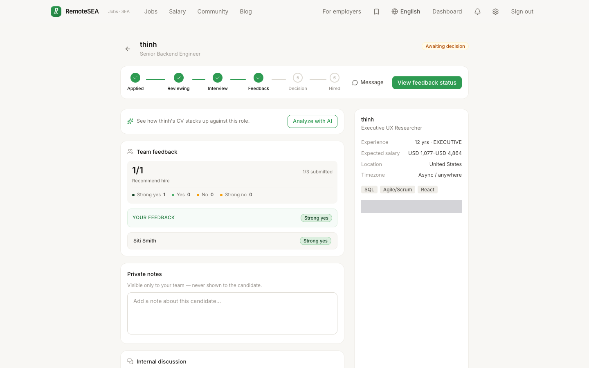

**Không chụp được:** scorecard-form (TimeoutError: locator.scrollIntoViewIfNeeded: Timeout 30000ms exceeded.)

### S3-WORKSPACE-OFFER — Không gian xử lý hồ sơ — ứng viên ở trạng thái Offer

| Thuộc tính         | Giá trị                                                                                                      |
| ------------------ | ------------------------------------------------------------------------------------------------------------ |
| Sprint             | 3                                                                                                            |
| PB                 | PB58 (Cập nhật trạng thái đơn ứng tuyển theo pipeline) PB65 (Xem tổng hợp phiếu đánh giá ứng viên)        |
| Actor chụp         | employer                                                                                                     |
| Route              | `/employer-dashboard/applications/:id` (đã mở: `/employer-dashboard/applications/cmt0vujv0007uoafa5ezgqxgr`) |
| Điều kiện truy cập | —                                                                                                            |
| Component          | —                                                                                                            |
| Trạng thái chụp    | `OK` → UI status `PARTIALLY_CAPTURED`                                                                        |
| Mức bằng chứng     | Runtime                                                                                                      |
| Lỗi API khi chụp   | GET /employer/jobs -> 500                                                                                    |
| DOM đo được        | 2 input · 0 form · 0 bảng · 3 link                                                                           |

Tiêu đề đo được trên trang (5)

- H1: Hai Doan
- H3: Team feedback
- H3: Private notes
- H3: Internal discussion
- H3: Activity

| Trạng thái UI             | Viewport            | Ảnh                                                                                                                                                          |
| ------------------------- | ------------------- | ------------------------------------------------------------------------------------------------------------------------------------------------------------ |
| Viewport desktop 1440×900 | desktop             | [PB58-employer-hiring-application-workspace-offer-desktop.png](screenshots/sprint-03/PB58-employer-hiring-application-workspace-offer-desktop.png)           |
| Toàn trang desktop        | desktop (full page) | [PB58-employer-hiring-application-workspace-offer-desktop-full.png](screenshots/sprint-03/PB58-employer-hiring-application-workspace-offer-desktop-full.png) |

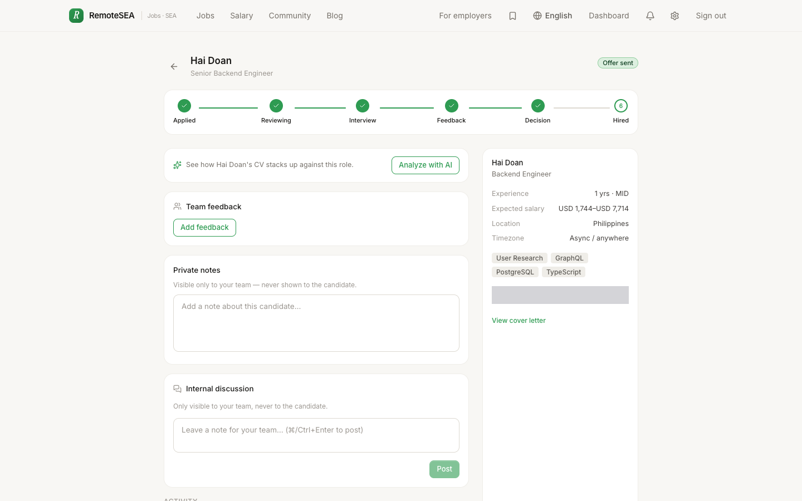

### S3-INTERVIEWS-UPCOMING — Lịch phỏng vấn sắp tới của đội tuyển dụng

| Thuộc tính         | Giá trị                                                                    |
| ------------------ | -------------------------------------------------------------------------- |
| Sprint             | 3                                                                          |
| PB                 | PB60 (Đề xuất lịch phỏng vấn cho ứng viên)                                 |
| Actor chụp         | employer                                                                   |
| Route              | `/employer-dashboard/interviews` (đã mở: `/employer-dashboard/interviews`) |
| Điều kiện truy cập | —                                                                          |
| Component          | —                                                                          |
| Trạng thái chụp    | `OK` → UI status `CAPTURED_NOT_INTERACTION_TESTED`                         |
| Mức bằng chứng     | Runtime                                                                    |
| DOM đo được        | 0 input · 0 form · 0 bảng · 1 link                                         |

Tiêu đề đo được trên trang (1)

- H1: Team interview schedule.

| Trạng thái UI             | Viewport            | Ảnh                                                                                                                            |
| ------------------------- | ------------------- | ------------------------------------------------------------------------------------------------------------------------------ |
| Viewport desktop 1440×900 | desktop             | [PB60-employer-interviews-upcoming-desktop.png](screenshots/sprint-03/PB60-employer-interviews-upcoming-desktop.png)           |
| Toàn trang desktop        | desktop (full page) | [PB60-employer-interviews-upcoming-desktop-full.png](screenshots/sprint-03/PB60-employer-interviews-upcoming-desktop-full.png) |

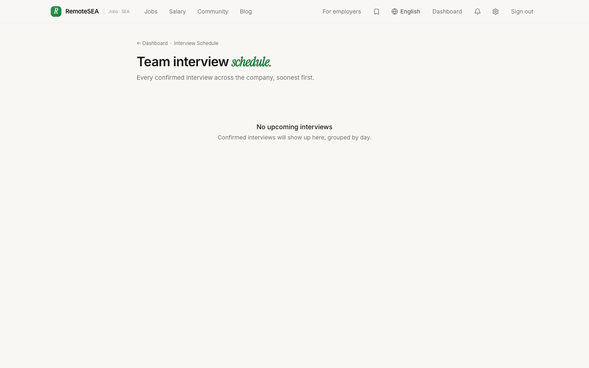

### S3-MESSAGES-EMPLOYER — Nhắn tin theo đơn ứng tuyển (nhà tuyển dụng)

| Thuộc tính         | Giá trị                                                                                  |
| ------------------ | ---------------------------------------------------------------------------------------- |
| Sprint             | 3                                                                                        |
| PB                 | PB68 (Nhắn tin trao đổi theo ngữ cảnh đơn ứng tuyển)                                     |
| Actor chụp         | employer                                                                                 |
| Route              | `/applications/:id/messages` (đã mở: `/applications/cmt2lgko7000cbmeondz7lhv8/messages`) |
| Điều kiện truy cập | —                                                                                        |
| Component          | —                                                                                        |
| Trạng thái chụp    | `OK` → UI status `CAPTURED_NOT_INTERACTION_TESTED`                                       |
| Mức bằng chứng     | Runtime                                                                                  |
| DOM đo được        | 1 input · 1 form · 0 bảng · 1 link                                                       |

Tiêu đề đo được trên trang (1)

- H1: thinh

| Trạng thái UI             | Viewport            | Ảnh                                                                                                                                      |
| ------------------------- | ------------------- | ---------------------------------------------------------------------------------------------------------------------------------------- |
| Viewport desktop 1440×900 | desktop             | [PB68-employer-messages-thread-employer-desktop.png](screenshots/sprint-03/PB68-employer-messages-thread-employer-desktop.png)           |
| Toàn trang desktop        | desktop (full page) | [PB68-employer-messages-thread-employer-desktop-full.png](screenshots/sprint-03/PB68-employer-messages-thread-employer-desktop-full.png) |

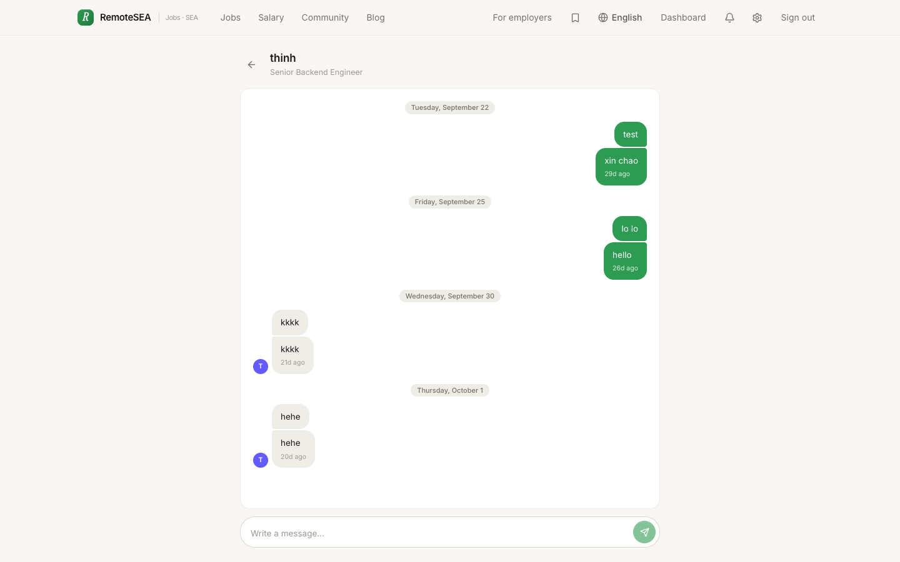

### S3-INTERVIEW-EMPLOYER — Lịch phỏng vấn (nhà tuyển dụng đề xuất / huỷ)

| Thuộc tính         | Giá trị                                                                                                         |
| ------------------ | --------------------------------------------------------------------------------------------------------------- |
| Sprint             | 3                                                                                                               |
| PB                 | PB60 (Đề xuất lịch phỏng vấn cho ứng viên) PB62 (Hủy lịch phỏng vấn) PB63 (Tải tệp lịch phỏng vấn (.ics)) |
| Actor chụp         | employer                                                                                                        |
| Route              | `/applications/:id/interview` (đã mở: `/applications/cmt2lgko7000cbmeondz7lhv8/interview`)                      |
| Điều kiện truy cập | —                                                                                                               |
| Component          | —                                                                                                               |
| Trạng thái chụp    | `OK` → UI status `CAPTURED_NOT_INTERACTION_TESTED`                                                              |
| Mức bằng chứng     | Runtime                                                                                                         |
| DOM đo được        | 0 input · 0 form · 0 bảng · 2 link                                                                              |

Tiêu đề đo được trên trang (2)

- H1: thinh
- H3: Team feedback

| Trạng thái UI             | Viewport            | Ảnh                                                                                                                                                |
| ------------------------- | ------------------- | -------------------------------------------------------------------------------------------------------------------------------------------------- |
| Viewport desktop 1440×900 | desktop             | [PB60-employer-interviews-interview-employer-desktop.png](screenshots/sprint-03/PB60-employer-interviews-interview-employer-desktop.png)           |
| Toàn trang desktop        | desktop (full page) | [PB60-employer-interviews-interview-employer-desktop-full.png](screenshots/sprint-03/PB60-employer-interviews-interview-employer-desktop-full.png) |

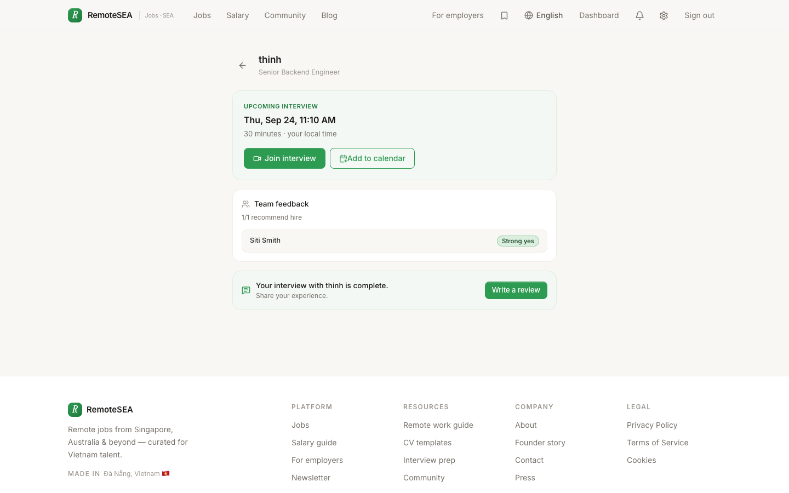

## Sprint 4 — Dịch vụ AI, Cảnh báo, Quản trị Admin & Tích hợp

### S4-SALARY — Tham khảo mức lương

| Thuộc tính         | Giá trị                                                    |
| ------------------ | ---------------------------------------------------------- |
| Sprint             | 4                                                          |
| PB                 | PB82 (Xem thông tin tham khảo mức lương (Salary Insights)) |
| Actor chụp         | guest                                                      |
| Route              | `/salary` (đã mở: `/salary`)                               |
| Điều kiện truy cập | Công khai                                                  |
| Component          | src/pages/SalaryPage.tsx → components/salary/*             |
| Trạng thái chụp    | `OK` → UI status `CAPTURED_NOT_INTERACTION_TESTED`         |
| Mức bằng chứng     | Runtime                                                    |
| DOM đo được        | 0 input · 0 form · 0 bảng · 1 link                         |

**Mục đích.** Tham khảo mức lương remote theo vai trò, quốc gia, cấp bậc (GET /salary/benchmarks*).

**Điều hướng.** Link 'Salary' trên navbar; khối 'Salary check' trên chi tiết việc làm dùng cùng dữ liệu.

Tiêu đề đo được trên trang (4)

- H1: What should you actually earn working remotely?
- H2: Salary by role & seniority
- H2: Where the money lives
- H2: Submit your salary, anonymously.

| Trạng thái UI             | Viewport            | Ảnh                                                                                                                            |
| ------------------------- | ------------------- | ------------------------------------------------------------------------------------------------------------------------------ |
| Viewport desktop 1440×900 | desktop             | [PB82-guest-salary-salary-insights-desktop.png](screenshots/sprint-04/PB82-guest-salary-salary-insights-desktop.png)           |
| Toàn trang desktop        | desktop (full page) | [PB82-guest-salary-salary-insights-desktop-full.png](screenshots/sprint-04/PB82-guest-salary-salary-insights-desktop-full.png) |
| Viewport mobile 390×844   | mobile              | [PB82-guest-salary-salary-insights-mobile.png](screenshots/sprint-04/PB82-guest-salary-salary-insights-mobile.png)             |
| Toàn trang mobile         | mobile (full page)  | [PB82-guest-salary-salary-insights-mobile-full.png](screenshots/sprint-04/PB82-guest-salary-salary-insights-mobile-full.png)   |

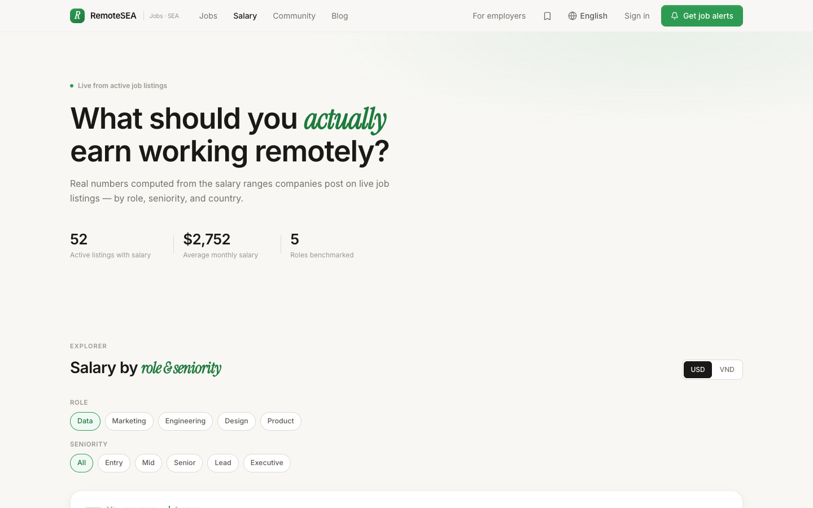

### S4-ALERTS — Cảnh báo việc làm

| Thuộc tính         | Giá trị                                                                                                        |
| ------------------ | -------------------------------------------------------------------------------------------------------------- |
| Sprint             | 4                                                                                                              |
| PB                 | PB76 (Tạo cảnh báo việc làm theo tiêu chí (Job Alert)) PB77 (Quản lý cảnh báo việc làm (Sửa, Bật/Tắt, Xóa)) |
| Actor chụp         | talent                                                                                                         |
| Route              | `/alerts` (đã mở: `/alerts`)                                                                                   |
| Điều kiện truy cập | —                                                                                                              |
| Component          | —                                                                                                              |
| Trạng thái chụp    | `OK` → UI status `CAPTURED_AND_VERIFIED`                                                                       |
| Mức bằng chứng     | Runtime                                                                                                        |
| DOM đo được        | 6 input · 1 form · 0 bảng · 0 link                                                                             |

Tiêu đề đo được trên trang (2)

- H1: Job alerts
- H2: Create a new alert

| Trạng thái UI                               | Viewport            | Ảnh                                                                                                                              |
| ------------------------------------------- | ------------------- | -------------------------------------------------------------------------------------------------------------------------------- |
| Viewport desktop 1440×900                   | desktop             | [PB76-talent-alerts-job-alerts-desktop.png](screenshots/sprint-04/PB76-talent-alerts-job-alerts-desktop.png)                     |
| Toàn trang desktop                          | desktop (full page) | [PB76-talent-alerts-job-alerts-desktop-full.png](screenshots/sprint-04/PB76-talent-alerts-job-alerts-desktop-full.png)           |
| Form tạo cảnh báo gửi rỗng → lỗi validation | desktop             | [PB76-talent-alerts-job-alerts-create-validation.png](screenshots/sprint-04/PB76-talent-alerts-job-alerts-create-validation.png) |
| Viewport mobile 390×844                     | mobile              | [PB76-talent-alerts-job-alerts-mobile.png](screenshots/sprint-04/PB76-talent-alerts-job-alerts-mobile.png)                       |
| Toàn trang mobile                           | mobile (full page)  | [PB76-talent-alerts-job-alerts-mobile-full.png](screenshots/sprint-04/PB76-talent-alerts-job-alerts-mobile-full.png)             |

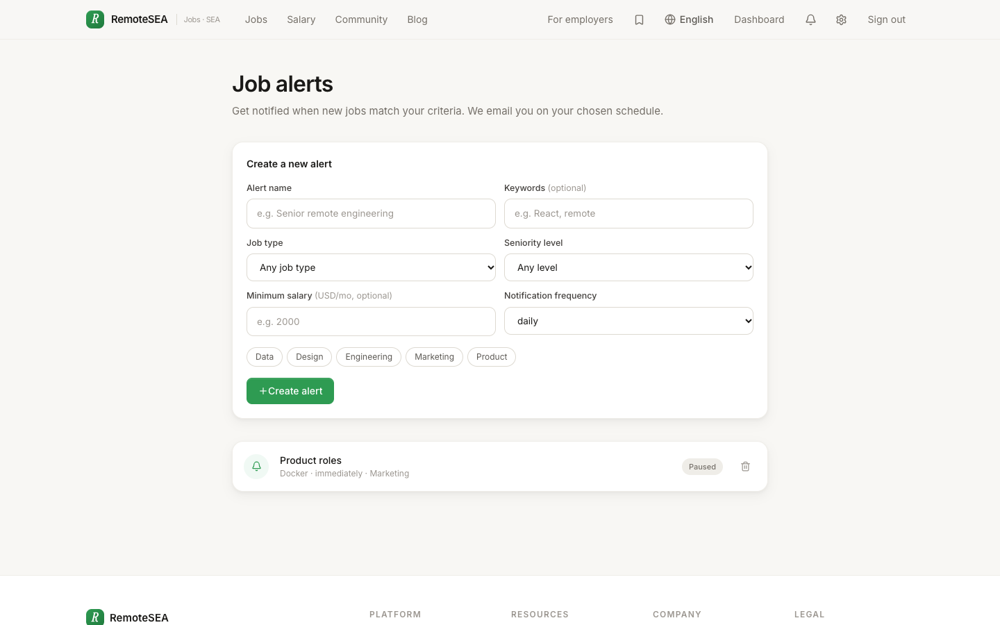

### S4-ROLE-GUARD — Ứng viên truy cập /admin → bị chuyển về trang chủ

| Thuộc tính         | Giá trị                                                 |
| ------------------ | ------------------------------------------------------- |
| Sprint             | 4                                                       |
| PB                 | PB92 (Thay đổi vai trò người dùng (Change User Role))   |
| Actor chụp         | talent                                                  |
| Route              | `/admin (talent)` (đã mở: `/admin` → `/`)               |
| Điều kiện truy cập | —                                                       |
| Component          | —                                                       |
| Trạng thái chụp    | `REDIRECT_AS_EXPECTED` → UI status `PARTIALLY_CAPTURED` |
| Mức bằng chứng     | Runtime                                                 |
| Lỗi API khi chụp   | GET /jobs -> 500                                        |
| DOM đo được        | 1 input · 1 form · 0 bảng · 20 link                     |

Tiêu đề đo được trên trang (16)

- H1: Remote jobs from Singapore, Australia & beyond — curated for Vietnam talent.
- H2: Simple. Curated. Built for you.
- H3: Browse verified jobs
- H3: Track applications in one place
- H3: Land your first remote offer
- H2: Find roles in your field
- H2: Know your worth before you negotiate.
- H2: Jobs open right now
- H3: Machine Learning Engineer
- H3: Marketing Operations Manager
- H3: Product Designer
- H3: Performance Marketing Specialist
- H2: Built by someone who's actually done it.
- H2: From apply to offer.
- H2: Looking for remote talent in Vietnam?
- H2: Don't miss the next opportunity.

| Trạng thái UI             | Viewport            | Ảnh                                                                                                                  |
| ------------------------- | ------------------- | -------------------------------------------------------------------------------------------------------------------- |
| Viewport desktop 1440×900 | desktop             | [PB92-talent-admin-role-guard-desktop.png](screenshots/sprint-04/PB92-talent-admin-role-guard-desktop.png)           |
| Toàn trang desktop        | desktop (full page) | [PB92-talent-admin-role-guard-desktop-full.png](screenshots/sprint-04/PB92-talent-admin-role-guard-desktop-full.png) |

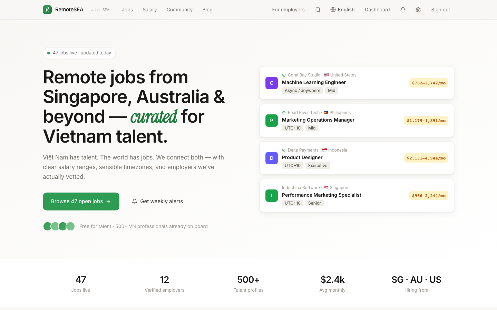

### S4-ADMIN-QUEUE — Admin — Hàng đợi kiểm duyệt tin

| Thuộc tính         | Giá trị                                                                                                                                                                  |
| ------------------ | ------------------------------------------------------------------------------------------------------------------------------------------------------------------------ |
| Sprint             | 4                                                                                                                                                                        |
| PB                 | PB85 (Xem hàng đợi tin tuyển dụng chờ kiểm duyệt) PB86 (Duyệt hoặc từ chối tin tuyển dụng) PB87 (Kiểm tra mức độ rủi ro tin tuyển dụng bằng AI (AI Risk Advisory)) |
| Actor chụp         | admin                                                                                                                                                                    |
| Route              | `/admin?tab=queue` (đã mở: `/admin?tab=queue`)                                                                                                                           |
| Điều kiện truy cập | —                                                                                                                                                                        |
| Component          | —                                                                                                                                                                        |
| Trạng thái chụp    | `OK` → UI status `CAPTURED_AND_VERIFIED` (đã thử lại 1 lần)                                                                                                              |
| Mức bằng chứng     | Runtime                                                                                                                                                                  |
| DOM đo được        | 1 input · 0 form · 0 bảng · 0 link                                                                                                                                       |

Tiêu đề đo được trên trang (2)

- H1: Hàng chờ duyệt
- H2: Data Analyst

| Trạng thái UI                 | Viewport            | Ảnh                                                                                                        |
| ----------------------------- | ------------------- | ---------------------------------------------------------------------------------------------------------- |
| Viewport desktop 1440×900     | desktop             | [PB85-admin-admin-queue-desktop.png](screenshots/sprint-04/PB85-admin-admin-queue-desktop.png)             |
| Toàn trang desktop            | desktop (full page) | [PB85-admin-admin-queue-desktop-full.png](screenshots/sprint-04/PB85-admin-admin-queue-desktop-full.png)   |
| Chọn tin thứ 2 trong hàng đợi | desktop             | [PB85-admin-admin-queue-item-selected.png](screenshots/sprint-04/PB85-admin-admin-queue-item-selected.png) |
| Viewport mobile 390×844       | mobile              | [PB85-admin-admin-queue-mobile.png](screenshots/sprint-04/PB85-admin-admin-queue-mobile.png)               |
| Toàn trang mobile             | mobile (full page)  | [PB85-admin-admin-queue-mobile-full.png](screenshots/sprint-04/PB85-admin-admin-queue-mobile-full.png)     |

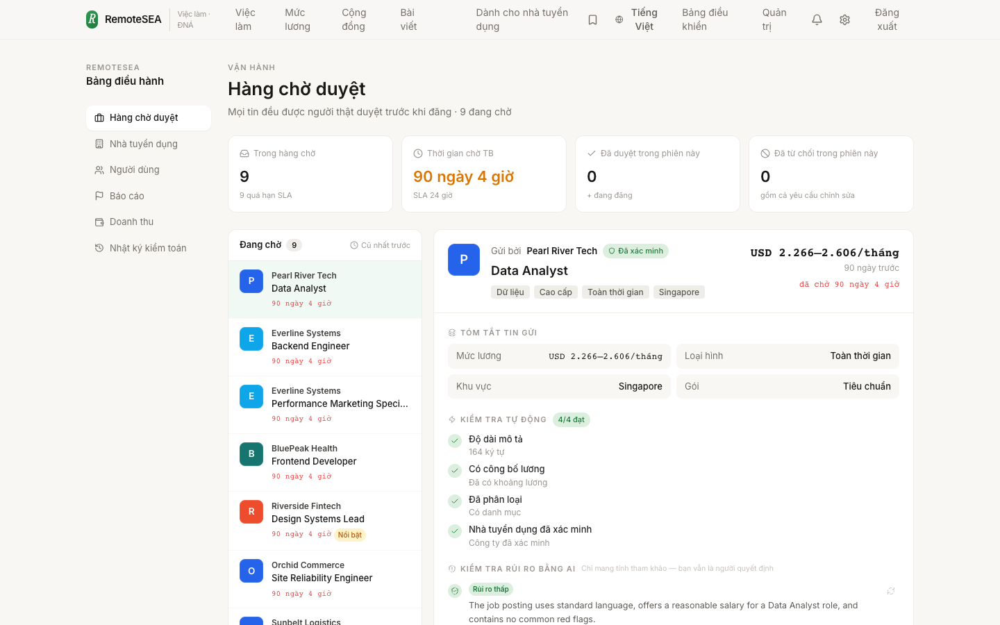

### S4-ADMIN-EMPLOYERS — Admin — Quản lý nhà tuyển dụng

| Thuộc tính         | Giá trị                                                                                                         |
| ------------------ | --------------------------------------------------------------------------------------------------------------- |
| Sprint             | 4                                                                                                               |
| PB                 | PB83 (Quản trị viên xác minh thủ công nhà tuyển dụng) PB84 (Quản trị viên đình chỉ hoạt động nhà tuyển dụng) |
| Actor chụp         | admin                                                                                                           |
| Route              | `/admin?tab=employers` (đã mở: `/admin?tab=employers`)                                                          |
| Điều kiện truy cập | —                                                                                                               |
| Component          | —                                                                                                               |
| Trạng thái chụp    | `OK` → UI status `CAPTURED_NOT_INTERACTION_TESTED`                                                              |
| Mức bằng chứng     | Runtime                                                                                                         |
| DOM đo được        | 1 input · 0 form · 0 bảng · 0 link                                                                              |

Tiêu đề đo được trên trang (1)

- H1: Nhà tuyển dụng

| Trạng thái UI             | Viewport            | Ảnh                                                                                                              |
| ------------------------- | ------------------- | ---------------------------------------------------------------------------------------------------------------- |
| Viewport desktop 1440×900 | desktop             | [PB83-admin-admin-employers-desktop.png](screenshots/sprint-04/PB83-admin-admin-employers-desktop.png)           |
| Toàn trang desktop        | desktop (full page) | [PB83-admin-admin-employers-desktop-full.png](screenshots/sprint-04/PB83-admin-admin-employers-desktop-full.png) |

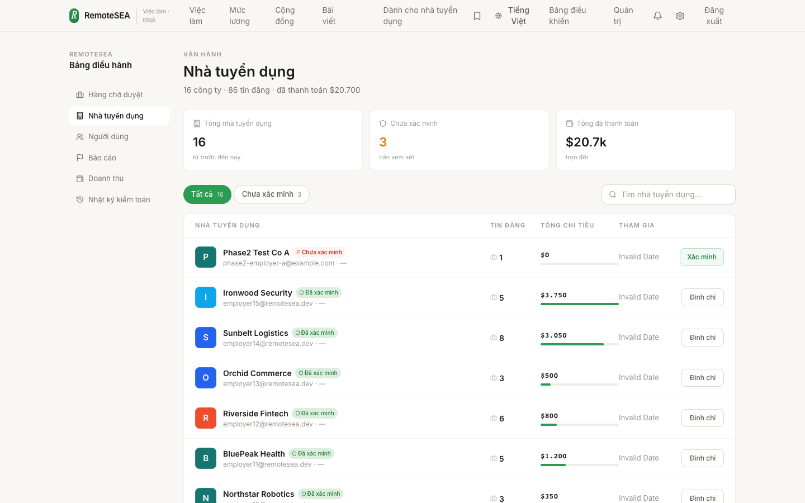

### S4-ADMIN-USERS — Admin — Quản lý người dùng

| Thuộc tính         | Giá trị                                                                                                                                                                                |
| ------------------ | -------------------------------------------------------------------------------------------------------------------------------------------------------------------------------------- |
| Sprint             | 4                                                                                                                                                                                      |
| PB                 | PB90 (Xem và tìm kiếm danh sách người dùng toàn hệ thống) PB91 (Khóa hoặc mở khóa tài khoản người dùng (Ban / Unban User)) PB92 (Thay đổi vai trò người dùng (Change User Role)) |
| Actor chụp         | admin                                                                                                                                                                                  |
| Route              | `/admin?tab=users` (đã mở: `/admin?tab=users`)                                                                                                                                         |
| Điều kiện truy cập | —                                                                                                                                                                                      |
| Component          | —                                                                                                                                                                                      |
| Trạng thái chụp    | `OK` → UI status `PARTIALLY_CAPTURED`                                                                                                                                                  |
| Mức bằng chứng     | Runtime                                                                                                                                                                                |
| Lỗi API khi chụp   | GET /admin/users -> 500                                                                                                                                                                |
| DOM đo được        | 1 input · 0 form · 0 bảng · 0 link                                                                                                                                                     |

Tiêu đề đo được trên trang (1)

- H1: Người dùng

| Trạng thái UI             | Viewport            | Ảnh                                                                                                            |
| ------------------------- | ------------------- | -------------------------------------------------------------------------------------------------------------- |
| Viewport desktop 1440×900 | desktop             | [PB90-admin-admin-users-desktop.png](screenshots/sprint-04/PB90-admin-admin-users-desktop.png)                 |
| Toàn trang desktop        | desktop (full page) | [PB90-admin-admin-users-desktop-full.png](screenshots/sprint-04/PB90-admin-admin-users-desktop-full.png)       |
| Lọc vai trò EMPLOYER      | desktop             | [PB90-admin-admin-users-filter-employer.png](screenshots/sprint-04/PB90-admin-admin-users-filter-employer.png) |
| Tìm kiếm 'talent'         | desktop             | [PB90-admin-admin-users-search.png](screenshots/sprint-04/PB90-admin-admin-users-search.png)                   |

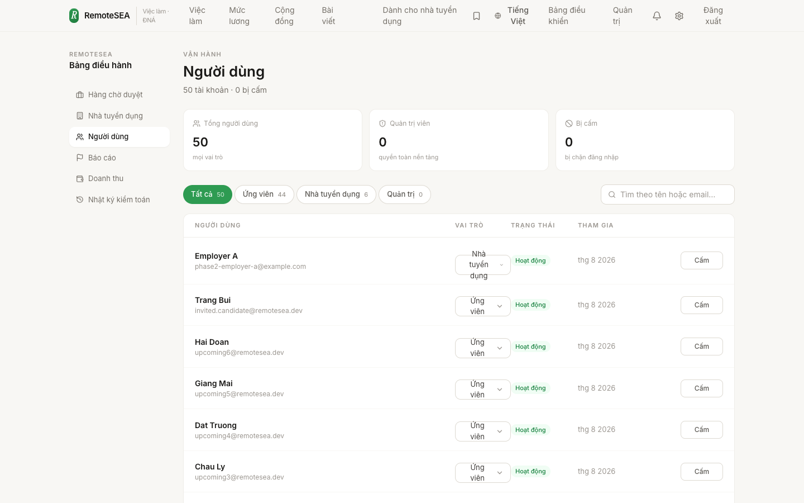

### S4-ADMIN-REPORTS — Admin — Xử lý báo cáo vi phạm

| Thuộc tính         | Giá trị                                                                                         |
| ------------------ | ----------------------------------------------------------------------------------------------- |
| Sprint             | 4                                                                                               |
| PB                 | PB89 (Quản trị viên xử lý báo cáo vi phạm) PB88 (Báo cáo tin tuyển dụng có dấu hiệu vi phạm) |
| Actor chụp         | admin                                                                                           |
| Route              | `/admin?tab=reports` (đã mở: `/admin?tab=reports`)                                              |
| Điều kiện truy cập | —                                                                                               |
| Component          | —                                                                                               |
| Trạng thái chụp    | `OK` → UI status `CAPTURED_NOT_INTERACTION_TESTED`                                              |
| Mức bằng chứng     | Runtime                                                                                         |
| DOM đo được        | 0 input · 0 form · 0 bảng · 3 link                                                              |

Tiêu đề đo được trên trang (1)

- H1: Báo cáo

| Trạng thái UI             | Viewport            | Ảnh                                                                                                          |
| ------------------------- | ------------------- | ------------------------------------------------------------------------------------------------------------ |
| Viewport desktop 1440×900 | desktop             | [PB89-admin-admin-reports-desktop.png](screenshots/sprint-04/PB89-admin-admin-reports-desktop.png)           |
| Toàn trang desktop        | desktop (full page) | [PB89-admin-admin-reports-desktop-full.png](screenshots/sprint-04/PB89-admin-admin-reports-desktop-full.png) |

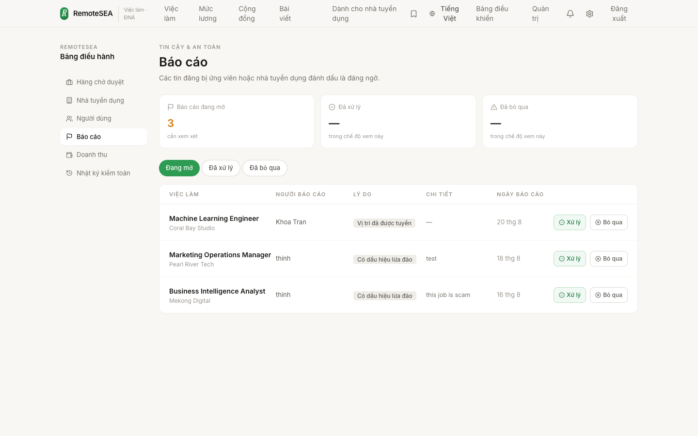

### S4-ADMIN-REVENUE — Admin — Doanh thu

| Thuộc tính         | Giá trị                                            |
| ------------------ | -------------------------------------------------- |
| Sprint             | 4                                                  |
| PB                 | UNMAPPED                                           |
| Actor chụp         | admin                                              |
| Route              | `/admin?tab=revenue` (đã mở: `/admin?tab=revenue`) |
| Điều kiện truy cập | —                                                  |
| Component          | —                                                  |
| Trạng thái chụp    | `OK` → UI status `IMPLEMENTED_BUT_UNMAPPED`        |
| Mức bằng chứng     | Runtime                                            |
| DOM đo được        | 0 input · 0 form · 0 bảng · 0 link                 |

Tiêu đề đo được trên trang (3)

- H1: Doanh thu
- H3: Doanh thu theo gói · từ trước đến nay
- H3: Giao dịch gần đây

| Trạng thái UI             | Viewport            | Ảnh                                                                                                                  |
| ------------------------- | ------------------- | -------------------------------------------------------------------------------------------------------------------- |
| Viewport desktop 1440×900 | desktop             | [UNMAPPED-admin-admin-revenue-desktop.png](screenshots/sprint-04/UNMAPPED-admin-admin-revenue-desktop.png)           |
| Toàn trang desktop        | desktop (full page) | [UNMAPPED-admin-admin-revenue-desktop-full.png](screenshots/sprint-04/UNMAPPED-admin-admin-revenue-desktop-full.png) |

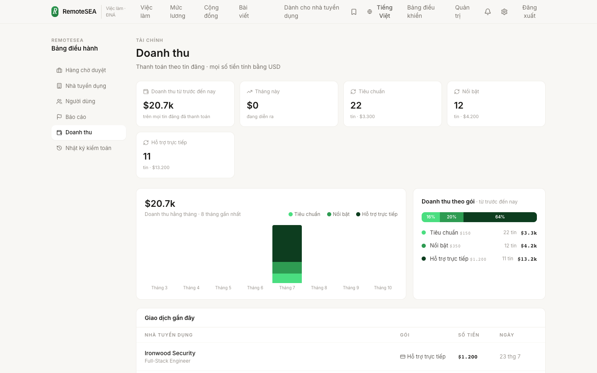

### S4-ADMIN-AUDIT-LOG — Admin — Nhật ký quản trị

| Thuộc tính         | Giá trị                                                 |
| ------------------ | ------------------------------------------------------- |
| Sprint             | 4                                                       |
| PB                 | PB93 (Xem nhật ký hành động quản trị (Admin Audit Log)) |
| Actor chụp         | admin                                                   |
| Route              | `/admin?tab=audit-log` (đã mở: `/admin?tab=audit-log`)  |
| Điều kiện truy cập | —                                                       |
| Component          | —                                                       |
| Trạng thái chụp    | `OK` → UI status `CAPTURED_NOT_INTERACTION_TESTED`      |
| Mức bằng chứng     | Runtime                                                 |
| DOM đo được        | 0 input · 0 form · 0 bảng · 0 link                      |

Tiêu đề đo được trên trang (1)

- H1: Nhật ký kiểm toán

| Trạng thái UI             | Viewport            | Ảnh                                                                                                              |
| ------------------------- | ------------------- | ---------------------------------------------------------------------------------------------------------------- |
| Viewport desktop 1440×900 | desktop             | [PB93-admin-admin-audit-log-desktop.png](screenshots/sprint-04/PB93-admin-admin-audit-log-desktop.png)           |
| Toàn trang desktop        | desktop (full page) | [PB93-admin-admin-audit-log-desktop-full.png](screenshots/sprint-04/PB93-admin-admin-audit-log-desktop-full.png) |

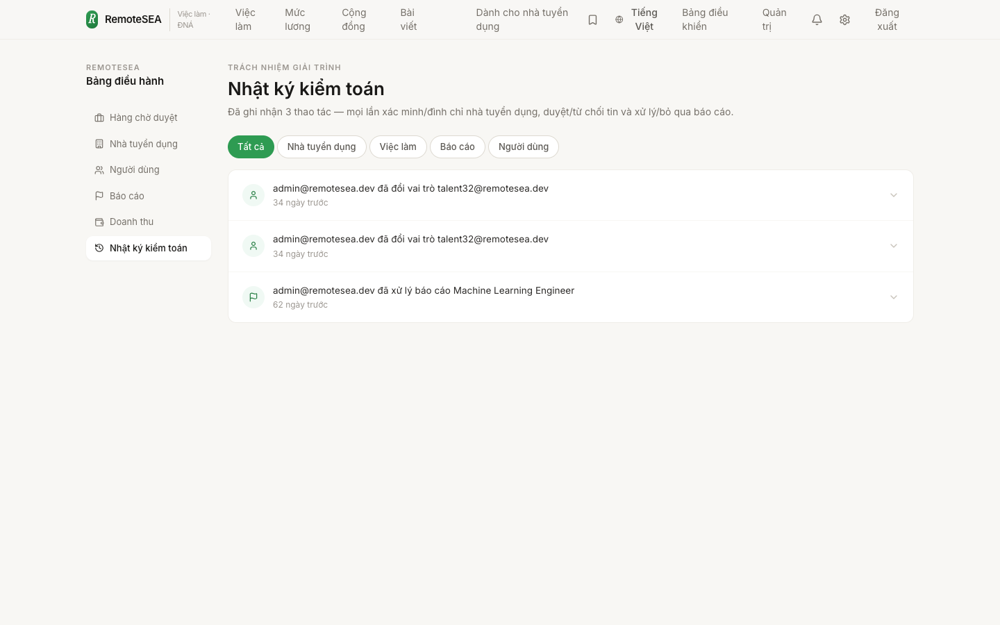

## Màn hình dùng chung / chưa ánh xạ PB

### SH-HOME — Trang chủ (Landing page)

| Thuộc tính         | Giá trị                                     |
| ------------------ | ------------------------------------------- |
| Sprint             | shared                                      |
| PB                 | UNMAPPED                                    |
| Actor chụp         | guest                                       |
| Route              | `/` (đã mở: `/`)                            |
| Điều kiện truy cập | Công khai                                   |
| Component          | src/pages/HomePage.tsx → components/home/*  |
| Trạng thái chụp    | `OK` → UI status `IMPLEMENTED_BUT_UNMAPPED` |
| Mức bằng chứng     | Runtime                                     |
| DOM đo được        | 1 input · 1 form · 0 bảng · 20 link         |

**Mục đích.** Landing page: giới thiệu nền tảng, dẫn vào tìm việc / đăng ký.

**Hạn chế / chưa xác minh.** Không có PB riêng cho landing page trong Product Backlog → UNMAPPED.

Tiêu đề đo được trên trang (16)

- H1: Remote jobs from Singapore, Australia & beyond — curated for Vietnam talent.
- H2: Simple. Curated. Built for you.
- H3: Browse verified jobs
- H3: Track applications in one place
- H3: Land your first remote offer
- H2: Find roles in your field
- H2: Know your worth before you negotiate.
- H2: Jobs open right now
- H3: Machine Learning Engineer
- H3: Marketing Operations Manager
- H3: Product Designer
- H3: Performance Marketing Specialist
- H2: Built by someone who's actually done it.
- H2: From apply to offer.
- H2: Looking for remote talent in Vietnam?
- H2: Don't miss the next opportunity.

| Trạng thái UI                  | Viewport            | Ảnh                                                                                                                   |
| ------------------------------ | ------------------- | --------------------------------------------------------------------------------------------------------------------- |
| Viewport desktop 1440×900      | desktop             | [UNMAPPED-guest-public-homepage-desktop.png](screenshots/shared/UNMAPPED-guest-public-homepage-desktop.png)           |
| Toàn trang desktop             | desktop (full page) | [UNMAPPED-guest-public-homepage-desktop-full.png](screenshots/shared/UNMAPPED-guest-public-homepage-desktop-full.png) |
| Mở menu điều hướng trên mobile | mobile              | [UNMAPPED-guest-public-homepage-mobile-menu.png](screenshots/shared/UNMAPPED-guest-public-homepage-mobile-menu.png)   |
| Viewport mobile 390×844        | mobile              | [UNMAPPED-guest-public-homepage-mobile.png](screenshots/shared/UNMAPPED-guest-public-homepage-mobile.png)             |
| Toàn trang mobile              | mobile (full page)  | [UNMAPPED-guest-public-homepage-mobile-full.png](screenshots/shared/UNMAPPED-guest-public-homepage-mobile-full.png)   |

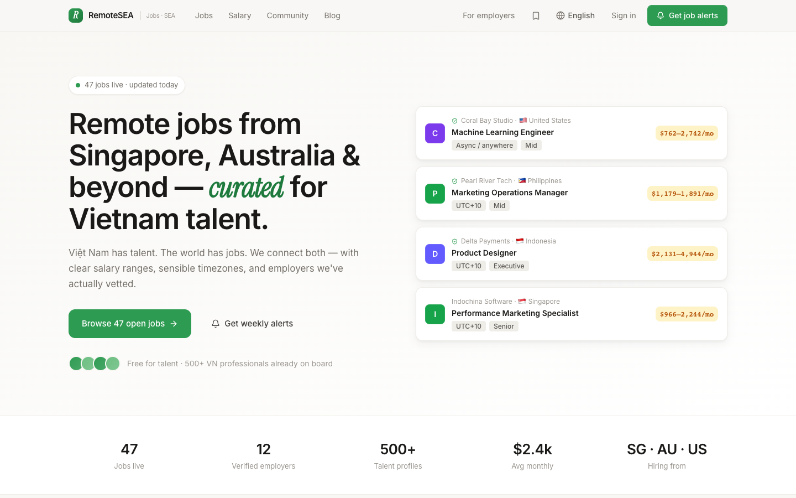

### SH-EMPLOYER-MKT — Trang giới thiệu cho nhà tuyển dụng (bảng giá, FAQ)

| Thuộc tính         | Giá trị                                                                                                  |
| ------------------ | -------------------------------------------------------------------------------------------------------- |
| Sprint             | shared                                                                                                   |
| PB                 | UNMAPPED                                                                                                 |
| Actor chụp         | guest                                                                                                    |
| Route              | `/employer` (đã mở: `/employer`)                                                                         |
| Điều kiện truy cập | Công khai                                                                                                |
| Component          | src/features/employer/pages/EmployerMarketingPage.tsx → employer-marketing/*, PricingSection, FAQSection |
| Trạng thái chụp    | `OK` → UI status `IMPLEMENTED_BUT_UNMAPPED`                                                              |
| Mức bằng chứng     | Runtime                                                                                                  |
| DOM đo được        | 0 input · 0 form · 0 bảng · 7 link                                                                       |

**Mục đích.** Trang giới thiệu cho nhà tuyển dụng: lợi ích, bảng giá gói đăng tin, FAQ.

**Hạn chế / chưa xác minh.** Không có PB riêng (sprint-routes.ts đánh dấu 'unassigned'). Bảng giá liên quan gián tiếp PB43/PB80.

Tiêu đề đo được trên trang (14)

- H1: Hire from Vietnam.The right way.
- H2: Smaller pool. Higher signal.
- H3: Better response rate
- H3: Median time to hire
- H3: Listings filled
- H2: Versus the alternatives.
- H2: List → review → match.
- H3: Submit your role
- H3: We review & verify
- H3: Receive matched candidates
- H2: One-time, not subscription.
- H2: "We hired our founding engineer in 11 days through RemoteSEA."
- H2: Honest answers.
- H2: Post your role today.Get applies by Friday.

| Trạng thái UI             | Viewport            | Ảnh                                                                                                                                       |
| ------------------------- | ------------------- | ----------------------------------------------------------------------------------------------------------------------------------------- |
| Viewport desktop 1440×900 | desktop             | [UNMAPPED-guest-public-employer-marketing-desktop.png](screenshots/shared/UNMAPPED-guest-public-employer-marketing-desktop.png)           |
| Toàn trang desktop        | desktop (full page) | [UNMAPPED-guest-public-employer-marketing-desktop-full.png](screenshots/shared/UNMAPPED-guest-public-employer-marketing-desktop-full.png) |
| Viewport mobile 390×844   | mobile              | [UNMAPPED-guest-public-employer-marketing-mobile.png](screenshots/shared/UNMAPPED-guest-public-employer-marketing-mobile.png)             |
| Toàn trang mobile         | mobile (full page)  | [UNMAPPED-guest-public-employer-marketing-mobile-full.png](screenshots/shared/UNMAPPED-guest-public-employer-marketing-mobile-full.png)   |

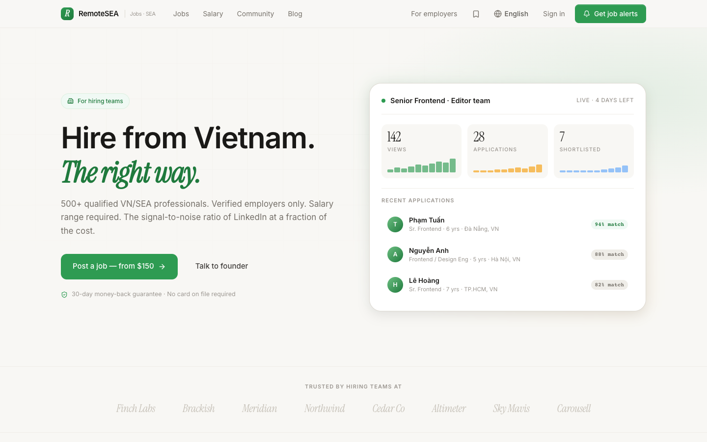

### SH-BLOG — Blog

| Thuộc tính         | Giá trị                                     |
| ------------------ | ------------------------------------------- |
| Sprint             | shared                                      |
| PB                 | UNMAPPED                                    |
| Actor chụp         | guest                                       |
| Route              | `/blog` (đã mở: `/blog`)                    |
| Điều kiện truy cập | Công khai                                   |
| Component          | src/pages/BlogPage.tsx                      |
| Trạng thái chụp    | `OK` → UI status `IMPLEMENTED_BUT_UNMAPPED` |
| Mức bằng chứng     | Runtime                                     |
| DOM đo được        | 2 input · 2 form · 0 bảng · 1 link          |

**Mục đích.** Trang nội dung Blog.

**Hạn chế / chưa xác minh.** Không có PB tương ứng (unassigned).

Tiêu đề đo được trên trang (11)

- H1: Field notes from remote work, written by the people doing it.
- H2: Why your offer is probably 22% too low — and the exact 4 sentences that fix it.
- H2: The archive
- H3: The 5pm shutdown ritual that saved my marriage (and my Loom usage).
- H3: What 612 remote offers told us about senior frontend pay.
- H3: I bombed 7 Stripe-loop interviews. Then I figured out the system.
- H3: Why I left a 6-figure FAANG offer to join a 22-person SG startup.
- H3: Standups are dead, long live the Friday roll-up.
- H3: Equity, RSUs, options — a Vietnamese employee's tax guide.
- H3: My async stack: Notion + Linear + Loom, and the glue between them.
- H2: Get the next essay, before it hits the site.

| Trạng thái UI             | Viewport            | Ảnh                                                                                                           |
| ------------------------- | ------------------- | ------------------------------------------------------------------------------------------------------------- |
| Viewport desktop 1440×900 | desktop             | [UNMAPPED-guest-public-blog-desktop.png](screenshots/shared/UNMAPPED-guest-public-blog-desktop.png)           |
| Toàn trang desktop        | desktop (full page) | [UNMAPPED-guest-public-blog-desktop-full.png](screenshots/shared/UNMAPPED-guest-public-blog-desktop-full.png) |

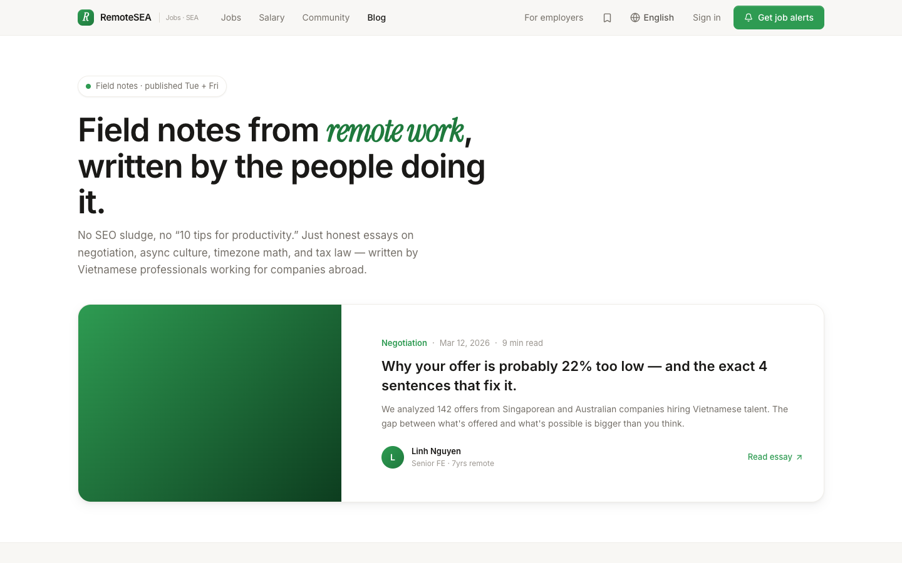

### SH-COMMUNITY — Cộng đồng

| Thuộc tính         | Giá trị                                              |
| ------------------ | ---------------------------------------------------- |
| Sprint             | shared                                               |
| PB                 | UNMAPPED                                             |
| Actor chụp         | guest                                                |
| Route              | `/community` (đã mở: `/community`)                   |
| Điều kiện truy cập | Công khai                                            |
| Component          | src/pages/CommunityPage.tsx → components/community/* |
| Trạng thái chụp    | `OK` → UI status `IMPLEMENTED_BUT_UNMAPPED`          |
| Mức bằng chứng     | Runtime                                              |
| DOM đo được        | 0 input · 0 form · 0 bảng · 0 link                   |

**Mục đích.** Trang Cộng đồng.

**Hạn chế / chưa xác minh.** Không có PB tương ứng (unassigned).

Tiêu đề đo được trên trang (5)

- H1: 500+ remote-working Vietnamese, one Slack.
- H2: The people actually in here.
- H2: What people actually talk about.
- H2: Coffee, beers, & offline bandwidth.
- H2: Ready to join the family?

| Trạng thái UI             | Viewport            | Ảnh                                                                                                                     |
| ------------------------- | ------------------- | ----------------------------------------------------------------------------------------------------------------------- |
| Viewport desktop 1440×900 | desktop             | [UNMAPPED-guest-public-community-desktop.png](screenshots/shared/UNMAPPED-guest-public-community-desktop.png)           |
| Toàn trang desktop        | desktop (full page) | [UNMAPPED-guest-public-community-desktop-full.png](screenshots/shared/UNMAPPED-guest-public-community-desktop-full.png) |

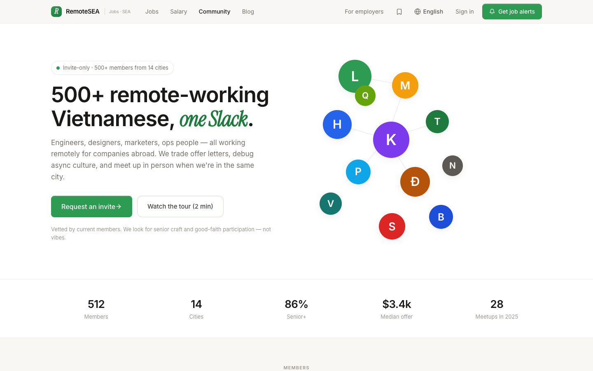

### SH-404 — Trang 404

| Thuộc tính         | Giá trị                                     |
| ------------------ | ------------------------------------------- |
| Sprint             | shared                                      |
| PB                 | UNMAPPED                                    |
| Actor chụp         | guest                                       |
| Route              | `*` (đã mở: `/this-page-does-not-exist`)    |
| Điều kiện truy cập | Công khai                                   |
| Component          | src/pages/NotFoundPage.tsx                  |
| Trạng thái chụp    | `OK` → UI status `IMPLEMENTED_BUT_UNMAPPED` |
| Mức bằng chứng     | Runtime                                     |
| DOM đo được        | 0 input · 0 form · 0 bảng · 1 link          |

**Mục đích.** Trang lỗi cho mọi URL không khớp route (catch-all '*').

Tiêu đề đo được trên trang (1)

- H1: Page not found

| Trạng thái UI             | Viewport            | Ảnh                                                                                                                   |
| ------------------------- | ------------------- | --------------------------------------------------------------------------------------------------------------------- |
| Viewport desktop 1440×900 | desktop             | [UNMAPPED-guest-error-not-found-desktop.png](screenshots/shared/UNMAPPED-guest-error-not-found-desktop.png)           |
| Toàn trang desktop        | desktop (full page) | [UNMAPPED-guest-error-not-found-desktop-full.png](screenshots/shared/UNMAPPED-guest-error-not-found-desktop-full.png) |

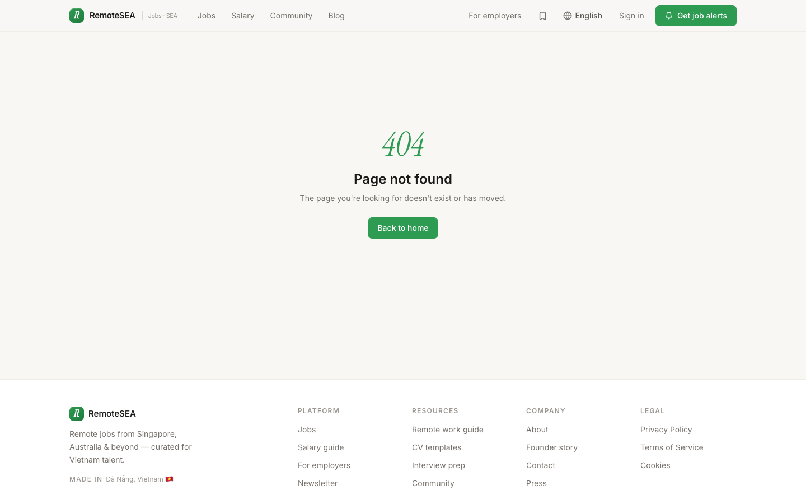
